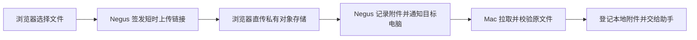

# Negus 公网附件上传问题与内测初步方案

整理日期 2026-11-20。对应需求 [FEAT-006 公网入口](../../project-management/items/FEAT-006/item.md) 和 [FEAT-003 附件](../../project-management/items/FEAT-003/item.md)。工作区基线为 `develop` 的 `40788d2`，用于定位本次核对的源码。

## 1. 您遇到的问题和需求

以下原话来自本次对话。

> 现在一个几百 k 的图片都要传半天，这才是我说的问题的关键，为什么这么慢？链路是不是有问题？是不是要服务器？

> 我现在连用negus传一个几m的文件都做不到

> 为什么不能直接把文件发给电脑？

> 怎么做？我要做什么？能不能我弄好你连上，就像现在cloudflare一样，我就不用操心？你的方案是什么？解决什么问题？有什么风险？

> 我的意思是说，我现在要想准备 negus 大规模内测，我需要做什么设施建设？我需要做什么来盈利？

用户在手机或外网浏览器里选图片或文件，点发送，希望很快看到发送结果，随后由个人电脑上的 Negus 收到原文件并交给助手。当前图片等待明显，几 MB 的文件也会失败。内测需要验证大陆普通网络、无需 VPN、内测用户无需自行配置。希望您只处理账号开通和费用等必要决策，接入、运维和排查由 Negus 负责。设备端继续保留原文件及其本地路径，沿用现有附件交付协议。另需明确内测设施、流量和成本，以及长期怎么收费。

## 2. 现有链路与实测

现有流程是浏览器把整份文件经 Cloudflare Tunnel 传给 Mac，Negus 写入本地并返回附件 ID，浏览器随后提交带附件的消息。单个附件上限为 20 MB。附件上传慢时，消息会卡在提交前。公网已有图片读取与纯文字此前未复现同等延迟。见[历史事故记录](NETWORK_UPLOAD_INCIDENT_2026-08-06.md)和[上传入口](../../../ui-feishu/shared/features/attachments/data/attachmentApi.ts)。

| 场景 | 文件 | 实测 |
| --- | --- | --- |
| 历史对照，同一张图片 | 约 120 KB | Mac 本机约 0.1 秒，现有公网入口约 10–16 秒 |
| 本次 Mac 本机同一上传接口 | 5 MiB / 20 MiB | 0.019 秒 / 0.022 秒，均成功 |
| 本次现有 Negus 公网入口 | 5 MiB / 20 MiB | 5 MiB 单独复测 25 秒超时，20 MiB 多次超时 |
| 本次临时域名 → Worker → 私有 R2 → Mac 下载 | 128 KiB | 上传 3.27 秒，下载 2.13 秒，共 5.40 秒，文件校验通过 |
| 同一临时 R2 路径 | 5 MiB | 单独复测上传 8.49 秒，下载 21.73 秒，共 30.22 秒，文件校验通过。其他轮次有失败 |
| 同一临时 R2 路径 | 20 MiB | 多次超时 |
| R2 管理 API | 5 MiB / 20 MiB | 均成功写入，列表返回的对象大小正确 |

实测范围是 Mac 当前网络和临时 Worker 入口。默认 `workers.dev` 入口在该网络上连接超时，成功样本使用独立测试域名。大陆手机直传和 R2 的 S3 预签名路径待分别测量。测试文件、Worker、临时域名和测试桶均已清理。

证据把问题范围缩到公网传输，具体慢在哪个网络段还需分段测量。5 MiB 成功的样本中，Mac 取回文件耗时约占全程七成。R2 已证明能存下 20 MiB，但这次试过的入口还达不到内测要求。仅增加服务器内存或把文件换个存储位置，都不会自动改善这两段公网线路。

## 3. 参考做法和可选设施

| 选项 | 与 Negus 的关系 |
| --- | --- |
| 直接发到电脑 | 局域网可直接传。异地时需要浏览器能稳定连到目标电脑，且电脑在线。现有 Tunnel 就是通过公开入口直达 Mac 的做法，当前公网样本出现明显延迟。 |
| Cloudflare R2 | 已开通，可用短时预签名链接做 S3 直传对照。标准存储每月免费含 10 GB·月、100 万次 A 类请求、1,000 万次 B 类请求，直接从 R2 下载免传输费。[官方定价](https://developers.cloudflare.com/r2/pricing/) · [预签名链接](https://developers.cloudflare.com/r2/api/s3/presigned-urls/) |
| 腾讯 COS / 阿里 OSS | 都支持短时签名直传。先选一家国内地域，与 R2 在同一批手机网络和 Mac 上对比。预算主要看存储、请求和公网下载，地域和套餐根据线路结果定。[COS](https://cloud.tencent.com/document/product/436/68284) · [OSS](https://www.alibabacloud.com/help/zh/oss/user-guide/upload-files-using-presigned-urls) |
| Google Cloud Storage | 可加入国际用户的候选。大陆内测优先比较面向目标用户的可达性和两段耗时。[签名链接](https://cloud.google.com/storage/docs/access-control/signed-urls) |
| Vultr 等云服务器 | 适合在实测证明某个区域中转能改善线路后作为中转，或在内测需要公共账号、消息和设备管理时承载控制服务。试用额度适合短期验证，长期预算按正常计费做。 |

Telegram 的公开接口把文件分片上传，随后在消息中引用文件。飞书开放平台也提供独立的图片、文件上传接口和资源引用。这些公开接口可以借鉴，客户端内部传输拓扑不在本次证据范围内。[Telegram 文件协议](https://core.telegram.org/api/files) · [飞书消息接口说明](https://open.feishu.cn/document/uAjLw4CM/ukTMukTMukTM/reference/im-v1/guide/faq)

## 4. 初步方案

**先用对象存储做公网附件入口，再用内测结果决定是否买服务器。** 内测首阶段复用现有 Negus 服务签发短时链接和处理消息。浏览器把文件字节直接发到测出来表现最好的私有对象存储。上传完成后，Mac 通过已有的连接收到附件信息，主动拉取原文件，验证大小和完整性，登记为 Negus 附件，再交给助手。

- **怎么选供应商。** 用大陆手机移动网络和家用 Wi-Fi，对比现有 Tunnel、R2 S3 直传、一家国内对象存储。以 128 KiB、5 MiB、20 MiB 测真实的「点发送 → 上传完成 → Mac 文件可用」，记录成功率、耗时分位数和失败阶段。可先提出内测门槛供确认，例如 5 MiB 的 95% 在 10 秒内可用、20 MiB 的 95% 在 30 秒内可用，且重复测试成功率至少 99%。不足以支持成功率结论的样本继续累积。
- **上线体验。** 上传有进度，失败可重试并保留草稿。云端收件和电脑已收到是两个状态。Mac 离线时告知等待电脑接收，恢复后自动取回。先对 20 MB 内文件验证简单直传，弱网重传成为主要问题时再上分片续传。
- **数据和费用。** 桶默认私有，签名限制用户、对象和有效期。按租户设置文件大小、上传量和并发配额。接收成功后按保留策略清理，配预算提醒和用量上限。手机上传快而 Mac 取回慢时，先比较存储地域或区域中转。
- **什么时候买服务器。** 第一阶段先做线路对照。线上多用户需要统一登录、设备在线状态、消息路由和配额时，再部署公共控制服务与数据库。控制服务只传少量元数据，文件绕开它。若实测两段线路有一段持续达不到门槛，再验证特定地域的中转，按对照结果决定是否采购。
- **您需要做什么。** R2 已开通。下一阶段只需由您决定是否批准新增付费资源及预算。连接、签名配置、测速、清理和后续告警由 Negus 处理，内测用户只需使用网页。

## 5. 内测容量和盈利方向

先用实际活跃量估基础设施，再按线路测试决定供应商。以下是预算模型，可替换为真实用量。

| 项目 | 估算示例 |
| --- | --- |
| 上传流量 | 100 名日活 × 每人每天 5 个附件 × 平均 2 MB = 约 1 GB/天、30 GB/月 |
| 取回流量 | 每份文件由 Mac 取回一次，约 30 GB/月。预览、重复下载和重试另计 |
| 存储 | 同一用量下保留 7 天，稳态约 7 GB。保留 30 天约 30 GB |
| 服务容量 | 文件直传时，对象存储负责文件吞吐。公共控制服务可从 1–2 vCPU、1–2 GB 内存做小规模试点，再用请求并发、数据库和任务指标扩容。这是起始估算 |
| R2 粗算 | 上述 7 天保留、请求留在免费额度内时，标准 R2 存储和请求费用为 0 美元。30 GB 平均存满一个账期，按当前费率和 10 GB·月免费额度，存储约 0.30 美元/月。独立计算、数据库和供应商费用另计。[官方定价](https://developers.cloudflare.com/r2/pricing/) |

首批内测可以用邀请制加配额获得真实的上传量、模型消费和服务负担。盈利方向是为远程使用个人电脑上的助手、多设备协作和自动化任务提供个人订阅，包含适量的附件与任务额度。再验证团队套餐和高用量加购，但先看用户留存与付费意愿。定价前按每活跃账户统计模型、存储、传输、服务和支持成本，避免试用补贴掩盖长期成本。
