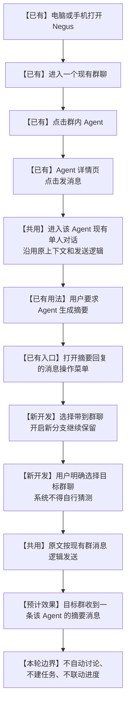

# 项目群聊与多 Agent 协作

## 2026-08-17 11:10 +08:00 当前产品决定

- 一个员工在一个项目群聊中对应员工自己项目下的一个长期会话；员工直属单聊与项目群聊会话分开，但都始终属于员工项目。
- 工作项目保存公共群聊和完整聊天记录，员工可以访问并操作目标项目文件，但不能在工作项目普通会话列表中留下员工 Thread。
- 首次调用默认按普通新会话开始，不自动加入此前完整群聊；后续调用补入该员工上一次回复之后的新群聊内容。
- 员工最终回复只生成一次，原样保留在员工会话并发布到工作项目群聊。
- 每日压缩、复盘、通用/项目经验和中止过程文本发布列为后续能力；归档、删除和退出当前不联动处理员工会话。
- 本次只确认并记录产品定义，尚未修复代码或完成运行验收。

## 用户原话

> 初版先做：我发送内容，项目经理回答我、安排其他Agent做，其他Agent做完之后在群里汇报结果。我@谁，谁就回我。没@就是项目经理判断自己回复还是让Agent干活之后回复还是怎么样。我想的是打好地基。

## 助手初步理解

当前目标不是先做多电脑调度，也不是把所有模型同时拉进来聊天，而是在一台电脑上建立一个可靠的 Agent 协作底座：用户只有一个群聊入口；项目经理负责接待、判断、拆解、分派和必要的汇总；用户明确 `@` 某个 Agent 时，该 Agent 直接负责响应；被项目经理安排的其他 Agent 完成后，在群里汇报结果。

模型和运行时需要解耦。Codex、Sol、Luna 等 Agent 角色可以使用 Codex、本地运行时或不同供应商 API 的模型；角色不应被写死为某一个模型。多电脑、远程节点和离线恢复只保留扩展边界，暂不进入初版主链路。Orca 暂不作为当前底座或强依赖。

## 计划评估结论

原开发计划的总体方向合理，与用户目标一致，尤其是“先单机多 Agent、后扩展多电脑”“项目经理统一路由”“模型与角色解耦”“分阶段验收”这几项判断应保留。

但原计划不能直接开工，原因是它把“Agent 能被调用”放得过早，把以下基础问题放得不够靠前：

1. 群聊消息必须有稳定身份、顺序和幂等键，否则用户消息或 Agent 回复可能重复、乱序或刷新后重新出现。
2. 任务不能只存在于内存队列中，否则服务重启后项目经理已经分派的任务会丢失执行状态。
3. 必须明确区分用户消息、项目经理路由决定、Agent 任务、Agent 执行和群内汇报，不能继续用一条回复文本承载全部状态。
4. 项目经理和 Worker 需要使用任务摘要、关联文件、验收标准和已有决策，不应每次把完整群聊复制给所有模型。
5. 停止、失败、重试、审批和部分完成必须有明确状态，否则用户无法判断 Agent 是没有收到任务、正在工作，还是已经失败。
6. 技术测试通过只能证明调用链按设计运行，不能证明用户体验完成；必须以真实群聊场景验收。

因此，本计划调整为：**先建立可靠的消息与任务账本，再做项目经理路由，再接入多 Agent 和多模型，最后完善协作体验与扩展接口。**

## 简短摘要

把已有的群聊原型升级为一个单机多 Agent 项目协作中心。用户始终从一个群聊入口工作，项目经理是默认接待者，`@` 是明确指定入口，专业 Agent 负责执行并公开汇报。所有消息、任务、执行记录、结果和交付物可以互相追溯。

## 产品目标

### 初版必须实现

- 用户直接发消息时，由项目经理统一接收。
- 项目经理可以直接回答，也可以说明任务安排后交给一个或多个专业 Agent。
- 用户 `@` 某个 Agent 时，被点名的 Agent 直接响应或执行任务。
- Agent 完成任务后，在同一个群里汇报结论、产物、风险和待确认事项。
- 用户可以继续追问原消息、原任务或某个 Agent 的结果，不需要重新描述完整背景。
- 用户能够看见任务处于等待、执行中、等待用户、已完成、失败、已停止或待审批中的哪一种状态。
- 同一条用户消息和同一份 Agent 结果不会因为实时事件、乐观显示、刷新或重连而重复出现。
- 服务重启后，已保存的群聊消息和未完成任务能够恢复为可解释状态。

### 初版不要求

- 所有 Agent 同时发言。
- 无限轮次的自主讨论。
- 项目经理每次都必须回答一遍；如果 Agent 已经给出足够结果，项目经理可以只做必要汇总。
- 自动接入所有模型供应商。
- 多电脑之间自动抢任务或自动执行。
- Orca 的整体迁移、Fork 或产品层接入。
- 企业级组织、计费、多租户和复杂权限系统。

## 核心用户流程

### 流程 A：普通消息由项目经理判断

```text
用户发送消息
  -> 保存用户消息并生成稳定 messageId
  -> 项目经理判断：直接回答 / 创建任务 / 请求补充信息
  -> 直接回答：项目经理回复并结束
  -> 创建任务：群里显示任务安排
  -> Worker 执行并持续更新状态
  -> Worker 在群里汇报结果
  -> 项目经理必要时汇总，不重复复述完整答案
```

### 流程 B：用户明确 `@Agent`

```text
用户 @ 指定 Agent
  -> 保存原始消息和目标 agentId
  -> 直接创建该 Agent 的任务或回复
  -> 该 Agent 在群里返回过程和结果
  -> 项目经理只有在用户要求汇总或存在冲突时介入
```

### 流程 C：用户追问、停止或打回

```text
用户回复某条消息或任务
  -> 读取 parentMessageId / taskId
  -> 只把相关任务摘要和必要证据交给目标 Agent
  -> 继续、停止、重试或打回修改
  -> 新结果写入同一任务链，不创建无法追溯的孤立回复
```

## 用户可见的目标体验

用户发送“帮我修复这个性能问题”时，先立即看到自己的消息和项目经理的安排，例如“我让开发 Agent 定位，审查 Agent 复核”。随后可以看到开发 Agent 的进度和结果；审查 Agent 完成后在群里说明风险或通过项；项目经理最后只补充必要结论。

用户发送“@研究 Agent 调研 Telegram 的处理方式”时，不会被其他 Agent 抢答。研究 Agent 直接接手，并在群里回报来源、结论和未确认信息。

用户刷新页面、手机切换设备或服务短暂重连时，历史消息不会重复，正在执行的任务不会凭空消失，任务状态能够说明是继续执行、等待恢复还是已经失败。

## 本轮产品逐项确认（已完成）

本轮按照用户要求逐项讨论，14 项核心要求已经确认。只有本节中标记为“已确认”的内容可以进入最终交接；本节之后的历史交接草案已经暂停，不得直接作为开发依据。

### 1. 功能目标（已确认）

用户在 Negus 与某个 Agent 单独沟通后，可以选择该 Agent 的一条回复，将它发送到用户明确选择的 Negus 群聊，并以该 Agent 的身份显示。

群消息发送后是否触发其他 Agent 回复，当前待定，不属于本项目标中的既定规则。

### 2. 单聊入口与页面形态（部分确认）

用户从 Negus 的 Agent 详情点击“发消息”，进入该 Agent 的完整单人对话页面。单聊不是弹窗或临时聊天。

一个 Agent 最终只保留一个连续对话窗口，还是允许用户围绕不同工作开启多个对话，当前保留意见。“一个联系人、多个工作话题”只作为后续功能候选，不进入本轮已确认范围。

### 3. Agent、项目与底层能力的关系（已确认）

Agent 是独立、长期存在的员工身份；项目负责管理事情、过程和成果，不负责定义 Agent 本身。一个 Agent 可以参与多个项目，一个项目也可以由多个 Agent 共同参与。

对话或任务只是 Agent 参与工作时产生的记录，不等同于 Agent 自身。Codex、GPT、OpenClaw、Hermes、其他 CLI、模型或服务属于 Agent 可以调用或承载工作的底层能力，Negus 不把任何一种底层能力直接写死为 Agent 身份。

Agent 的长期方向是形成可以持续反思、纠错和提升的“自我”。其稳定身份、长期记忆、技能能力、工作反思和改进记录应能够跨项目保留；具体演进规则、用户控制方式和回退机制后续逐项确认。

### 4. 单聊记录的归属与保存（已确认）

用户与某个 Agent 的单聊记录统一归在该 Agent 名下。以后即使更换模型、CLI 或其他底层服务，用户仍然面对同一个 Agent，原有记录不会因此变成另一个员工或消失。

单聊记录应优先保存为本地文件。具体文件格式、目录结构、同步方式、删除和归档规则尚未确认，由技术侧先研究可行方案，后续再作产品决定。

### 5. 带到群聊的内容选择单位（已确认）

用户针对单聊中某一条已经完成的 Agent 回复进行操作，而不是一次发送整个单聊记录。

是否支持一次选择多条消息、用户消息、附件或发送前编辑，当前尚未确认，后续分别讨论。

### 6. 消息操作入口与 UI 形式（已确认）

在单聊消息现有的“分支”图标旁增加一个分享图标。分享图标复用现有分支图标的尺寸、位置、交互方式和反馈样式，保持消息操作区域一致；原有分支功能和逻辑不变。

分享图标使用独立逻辑。其说明文字为“带到群聊”，点击后进入目标群聊选择，不立即发送消息。

### 7. 目标群聊选择（已确认）

点击分享图标后，显示该 Agent 可以发送消息的 Negus 群聊列表，由用户明确选择一个目标群聊。系统不根据用户此前从哪个群聊进入单聊而自动判断目标。

即使当前只有一个可选群聊，也显示该群聊并由用户点击确认，以保留未来多个群聊的一致使用逻辑。

### 8. 选定群聊后的发送方式（已确认）

用户点击目标群聊后，直接发送所选 Agent 回复当前显示的原文，不增加预览、编辑、重新总结或再次确认页面。目标群聊选择本身就是确认动作。

### 9. 发送结果反馈（已确认）

发送成功后，用户留在当前单聊并看到消息已经发送到所选群聊。发送失败时只显示“发送失败”，不增加复杂的失败处理流程。

### 10. 群内消息显示（已确认）

消息按照目标群现有的 Agent 消息样式显示，只展示 Agent 身份和正文。本轮不增加“来自单聊”标签或来源链接。

### 11. 消息进入群聊后的 Agent 触发（已确认）

本轮只完成消息进入群聊，不新增自动触发其他 Agent 的规则。未来如有需要，再单独设计相关功能；本轮实现不得限制后续扩展。

### 12. 本轮发送的内容范围（已确认）

本轮发送所选 Agent 回复的文字和 Markdown 正文。图片、附件、Artifact 和工具过程本体暂不复制到群聊；相关文件路径或链接作为文字保留。

### 13. 设备范围（已确认）

电脑和手机都提供相同的分享入口、目标群聊选择和结果反馈，本功能不能只在电脑端使用。

### 14. 重复发送与按钮状态（已确认）

发送过程中暂时禁用分享按钮，保证一次操作只产生一条群消息；发送结束后，用户仍可主动再次发送。

分享按钮在发送过程中必须保持可见，只改变为禁用和处理中状态，不得隐藏按钮或造成消息操作区域跳动。

## 历史交接草案（已暂停）：将 Agent 单聊摘要带到指定群聊

### 交接结论

本轮只开发一个闭环：用户从群聊中的 Agent 详情进入该 Agent 已有的单人对话，在现有单人对话中让 Agent 生成摘要，再通过该摘要消息已有的操作入口，把摘要原文以该 Agent 身份发送到用户明确选择的群聊。

本交接已经完成产品范围确认。技术总监不需要继续讨论总监组织架构、自动多 Agent 协作、项目进度联动、摘要编辑或多运行服务接入；这些内容都不属于本轮。

- 产品交接基线：`434cb404169e018d64474ab3f76566c8ebaf5608`
- 交接状态：产品规则已确认，可以进入技术拆解和开发
- 开发原则：优先共用现有页面、对话、消息菜单和群聊发送能力，只补齐单聊摘要到指定群聊的最短路径
- 用户可见结果：用户不再手动复制摘要、切换群聊并冒充 Agent 发言；Agent 会像普通员工一样，在用户指定的群聊中发送这份摘要

### 用户已经确认的意见

1. Agent 应被当作正常员工。Agent 不应因为用户此前从某个群聊进入单聊，就自行猜测摘要应该发回哪个群聊；用户必须明确告诉 Agent 目标群聊。
2. 多个群聊的产品方向必须保留。本轮的“带到群聊”不能写死为发送到唯一群聊，也不应破坏既有或后续的多群聊能力。
3. Agent 详情页、详情页中的“发消息”、单人对话页和单人对话上下文均按现有产品逻辑使用，不重新制作另一套 Agent 单聊。
4. 摘要由用户在单聊中正常要求 Agent 生成。现有产品没有摘要编辑器，本轮不增加编辑、预览或再次生成步骤。
5. 复用现有助手回复上的“开启新分支”操作入口，在它所在的二级菜单中增加“带到群聊”。“开启新分支”原有功能继续保留。
6. 发送成功后，目标群聊中只新增一条由该 Agent 发出的摘要消息；不因此自动邀请其他 Agent，不自动形成讨论、结论、待定事项或项目任务。
7. 本轮不增加“来自单聊”标识、不增加返回原单聊链接，也不增加底层模型、CLI、OpenClaw 或其他运行服务的展示与选择。
8. 产品长期方向是：每个 Agent 未来可能使用不同模型，也可能不以 Codex 为底层，而使用其他 CLI、OpenClaw、API 或其他服务。该方向仅作为后续背景记录，不扩大本轮开发范围。
9. 开发成本必须受控。能够直接挪用、借用或共用现有逻辑的部分，不得重新设计或重做。

### 当前观察到的产品基础

以下内容来自 2026-08-08 对当前运行页面和现有项目资料的核对：

- Negus 已能在电脑网页和手机宽度页面中打开，同一产品中已有“对话”“群聊”“进度”入口。
- 当前群聊已有群消息时间线、群内 Agent、Agent 详情、模型与推理强度设置、普通群消息、`@Agent`、商讨/开发模式和附件入口。
- 当前运行页面实际显示的是 `negus 项目群` 和项目经理、研究、开发、审查四位 Agent，不是此前错误描述的“一人公司群聊”或三位总监群。
- 单人页已有长期对话、上下文、消息发送和助手回复后的分支能力；用户进一步确认，Agent 详情页已有“发消息”入口，可以进入相应单人对话。
- 单人对话和群聊已经处于同一个 Negus 应用中，可以在不重做整个页面外壳的情况下复用已有体验。
- 当前运行页面本轮只核对到一个项目群视图；多群聊是必须保留的产品方向。本轮只需要让目标群选择使用现有可用群聊数据，不新增群聊创建、删除、成员管理或权限系统。

### 现有能力与开发处理

| 产品能力 | 当前情况 | 本轮处理 | 修改后的预计效果 |
| --- | --- | --- | --- |
| 电脑和手机进入 Negus | 已有 | 直接共用 | 两端都从现有 Negus 使用本功能，不增加独立入口 |
| 群聊及群内 Agent | 已有 | 直接共用 | 用户从任一现有群聊点击 Agent |
| Agent 详情页 | 已有 | 直接共用 | 保留现有身份、职责和设置展示 |
| 详情页“发消息” | 用户确认已有 | 接通现有单人对话，不重做页面 | 用户进入该 Agent 原来的单人对话，而不是创建另一种临时聊天 |
| 单人对话与上下文 | 已有 | 直接共用 | Agent 延续该单聊已有上下文，用户正常要求它总结 |
| Agent 生成摘要 | 已有普通对话能力 | 不增加专门摘要工具 | 摘要就是一条普通、已经完成的 Agent 回复 |
| “开启新分支”操作 | 已有 | 保留原功能，在同一二级菜单增加一个同级动作 | 用户仍可开启分支，也可以选择“带到群聊” |
| 目标群聊选择 | 本闭环缺少 | 新开发最小群聊选择界面 | 用户明确选择摘要要发送到哪个现有群聊，系统不猜测 |
| Agent 身份发送群消息 | 群聊已有 Agent 消息展示和发送逻辑 | 补齐从单聊摘要到目标群聊的连接，优先共用现有逻辑 | 目标群里出现一条以该 Agent 身份发送的摘要消息 |
| 群聊消息反馈 | 已有群消息反馈逻辑 | 直接共用 | 成功或失败沿用现有反馈，不增加新页面 |
| 多 Agent 自动讨论 | 当前已有部分群聊调度能力 | 本轮不触发、不扩展 | 摘要进入群聊后保持为一条普通 Agent 消息 |
| 多模型和多运行服务 | 长期方向 | 本轮不开发 | 不增加任何新设置或接入，不影响本轮最小闭环 |

### 修改后的完整用户流程

| 步骤 | 用户所在位置 | 用户操作 | 系统行为与反馈 |
| --- | --- | --- | --- |
| 1 | 电脑浏览器或手机 Negus | 打开现有 Negus | 显示现有应用和群聊入口，不进入新应用 |
| 2 | 群聊列表或现有群聊入口 | 进入一个已有群聊 | 显示该群现有消息、成员和 Agent |
| 3 | 目标群聊 | 点击想单独沟通的 Agent | 打开现有 Agent 详情页 |
| 4 | Agent 详情页 | 点击“发消息” | 进入该 Agent 现有的单人对话，不创建另一套详情或聊天页面 |
| 5 | Agent 单人对话 | 按现有方式与 Agent 沟通，并要求“请把刚才内容总结成一份摘要” | Agent 使用现有单聊上下文，返回一条普通摘要回复 |
| 6 | 已完成的摘要回复 | 打开该回复现有的消息操作二级菜单 | 原有“开启新分支”仍在，同时显示新增的“带到群聊” |
| 7 | 目标群选择 | 点击“带到群聊”后，从现有群聊中明确选择一个目标群 | 不根据来源页面、最近打开记录或历史关系自动选择群聊；用户必须亲自选择 |
| 8 | 仍在单人对话 | 完成群聊选择 | 系统直接取用这条摘要的现有文字，不打开编辑器、不重新总结、不改变内容 |
| 9 | 发送过程 | 等待现有发送结果 | 沿用现有消息发送成功或失败反馈；不新增独立发送页面 |
| 10 | 目标群聊 | 用户之后进入所选群聊查看 | 时间线中出现一条由该 Agent 发出的摘要消息；其他群聊没有这条消息 |
| 11 | 目标群聊 | 用户按需继续发言或主动 `@` 其他 Agent | 沿用现有群聊逻辑；摘要本身不自动启动其他 Agent |



### 必须遵守的产品规则

1. **目标群必须由用户选择。** 不设置“刚才所在群聊”“最近群聊”或其他隐式默认值。
2. **Agent 按普通员工理解。** 目标群选择只使用 Agent 按现有产品规则可以发送消息的群聊；本轮不静默把 Agent 加入新群，也不新增权限体系。
3. **只处理已完成的 Agent 文字回复。** 回复仍在生成、为空、只有系统状态或只有附件时，不显示或不启用“带到群聊”。
4. **摘要原文发送。** 不增加编辑、预览、格式转换、再次总结或自动润色。
5. **本轮只带文字。** 图片、附件、Artifact、工具过程和完整单聊历史不随摘要进入群聊。
6. **群内作者是该 Agent。** 不是用户代发，也不是系统通知。
7. **只进入用户选择的一个群聊。** 不广播到多个群，不复制到原群，不根据进入路径推断另一个群。
8. **发送后不自动触发协作。** 其他 Agent、项目经理和任务系统都不因这条消息自动启动；用户以后主动发言或 `@` 时才沿用现有群聊行为。
9. **现有“开启新分支”不得回归。** 新菜单项与它并列，不能替换、改名或改变其原有行为。
10. **失败不得制造假结果。** 发送失败时，目标群不能出现成功消息；用户保留在原单聊，可再次使用同一操作重试。
11. **重复操作不得无提示地产生多条消息。** 优先沿用现有群消息防重复能力；验收时必须确认一次操作只新增一条消息。
12. **不强制跳转页面。** 发送后用户仍留在当前单聊，沿用现有操作反馈；本轮不增加“查看来源”“返回单聊”或新的结果页。

### 本轮明确需要新开发的内容

1. 在已完成的 Agent 回复现有消息操作二级菜单中增加“带到群聊”。
2. 点击后显示现有可发送群聊的最小选择列表；即使当前只有一个可选群，也必须由用户点击确认目标。
3. 把被选择的 Agent 回复文字和 Agent 身份交给现有群消息发送能力。
4. 确保目标群只新增一条该 Agent 消息，且不会触发自动 Agent 调度。
5. 在电脑和手机上完成同一流程，不能只在桌面端提供菜单或群选择。

### 本轮明确不开发的内容

- 不创建“一人公司群聊”或新的群聊类型。
- 不绑定产品总监、制作与研发总监、COO 等三个长期对话。
- 不新增 Agent、总监席、公司架构、上下级或执行员工管理。
- 不新增摘要按钮、摘要模板、摘要编辑器、预览页或二次确认页。
- 不增加“来自单聊”标识、原消息链接、返回单聊或来源追踪页面。
- 不自动邀请其他 Agent，不自动讨论、汇总、裁决或生成待定事项。
- 不创建项目任务，不同步负责人、进度、飞书或其他办公系统。
- 不新增群聊创建、删除、成员管理、权限或企业组织能力。
- 不接入新的模型、CLI、OpenClaw、API 或 Agent Runtime，也不新增对应设置。
- 不重做现有单人页、群聊页、Agent 详情页或消息发送反馈。

### 修改后的预计效果

用户在手机或电脑上，可以像找一名真实员工一样，从群聊进入某个 Agent 的详情和单聊，利用它已经积累的单聊上下文完成深入沟通。Agent 给出摘要后，用户不再复制文字、返回群聊、手动粘贴，也不需要冒充 Agent 发言；用户只需选择“带到群聊”并明确指定目标群，目标群就会出现一条由该 Agent 本人发送的摘要消息。

这一修改解决的是单聊与群聊之间最短、最明确的内容流转问题。它不会改变现有群聊的发言规则，不会扩大成自动公司管理，也不会提前承担项目进度和跨运行服务接入的成本。

### 验收标准

1. **电脑主流程**：从一个群聊点击 Agent，进入详情并打开其现有单聊；生成摘要后，可以从现有消息操作菜单选择“带到群聊”。
2. **手机主流程**：在手机宽度页面完成同样操作，菜单、群聊选择和发送结果均可见、可点击，不依赖电脑端。
3. **明确选择目标**：即使用户从群聊 A 进入单聊，系统也不自动选择 A；用户必须在列表中明确选择 A、B 或其他可用群聊。
4. **多群准确性**：选择群聊 B 后，只有 B 出现新消息，A 和其他群聊不出现副本。
5. **内容一致性**：群里的正文与用户选择的摘要回复文字一致，没有自动编辑、删减、扩写或重新总结。
6. **身份正确**：群消息作者显示为原单聊 Agent，而不是用户或系统。
7. **无自动扩散**：消息进入群后，没有其他 Agent 因此自动回复，没有新任务、待定事项或进度记录。
8. **原功能不回归**：“开启新分支”仍可正常使用，单人页原有上下文、发送和回复行为不变。
9. **失败可理解**：发送失败时不出现假成功消息，用户仍在原单聊，可以再次操作。
10. **一次一条**：一次成功操作只在目标群新增一条消息，快速重复点击不得产生无法解释的重复消息。
11. **范围检查**：页面中没有新增摘要编辑器、来源链接、运行服务设置、总监绑定或项目联动入口。

### 长期产品背景，不进入本轮开发

未来的 Agent 是稳定的员工身份，底层可能分别使用 Codex、其他模型、其他 CLI、OpenClaw、API 或其他运行服务。同一个群中也可能同时存在底层不同的 Agent。用户面对的仍应是统一的 Agent 身份、单聊和群聊体验，而不是被迫理解底层工具差异。

本轮只记录这一方向，不要求技术总监为其他运行服务新增界面、选择器、适配或架构改造，也不能借此扩大当前修改范围。

### 本轮产品讨论中的错误与纠正

本轮前期产品讨论出现了连续的范围和事实错误，技术交接必须保留这些记录，避免开发再次沿错误方向推进：

1. **没有先核对当前产品，就虚构“一人公司群聊”。** 当前真实页面是现有项目群，不是新的一人公司群聊。本轮不创建新群聊类型。
2. **没有确认手机端，就擅自把入口限定为电脑。** 当前 Negus 已有手机页面；本轮必须同时保留电脑和手机体验。
3. **把已有 Agent 展示误说成新增能力。** 当前群聊已经显示 Agent，因此本轮不是开发固定 Agent 展示。
4. **过早提出绑定三位总监长期对话。** 该方向尚未完成产品规则确认，并且不是本轮最小目标，已明确移出范围。
5. **把单聊与群聊关系扩展成摘要预览、编辑、结论回写和自动协作。** 用户已经明确要求先共用现有逻辑，因此这些额外流程全部取消。
6. **错误提出默认发送到“刚才所在的群聊”。** Agent 应像正常员工一样，由用户明确告知目标群聊，不能根据用户进入路径自行猜测。
7. **重复询问已经确定的摘要编辑问题。** 当前没有编辑逻辑，产品决定就是不新增；不应把已确认的最小范围重新抛给用户。
8. **提前加入来源标识和跨运行服务展示。** 用户已决定这两项本轮都不加；多模型、多 CLI 只是长期背景。
9. **没有优先考虑实际开发成本。** 正确边界是先复用 Agent 详情、发消息、单人页、上下文、助手回复操作和群消息逻辑，只开发必要连接。

这些错误导致用户反复纠正同一基础事实，延迟了产品交接，也使今天的开发目标一度从一个最小内容流转功能扩大成组织架构和自动协作设计。当前章节中的范围与验收标准替代此前聊天中所有冲突描述。

### 技术总监交接要求

技术总监应先核对上述“已有能力”在当前产品中的实际入口，然后只实现五项新增内容。若发现某项被标记为“已有”的能力在当前代码或运行页面中不存在，应明确指出具体缺口及其对本轮路径的影响，不得自行扩展成新的群聊管理、Agent 管理或运行服务系统。

交付时必须说明：用户从哪里进入、复用了哪些现有能力、新开发了哪些用户可见行为、电脑和手机分别如何验收、哪些明确未做。产品验收以本章节为准，不以此前聊天中的扩展设想为准。

## 基础架构边界

```text
Negus 群聊层
  房间、消息、线程关联、任务、状态、交付物、审批
        -> Agent 路由层
  项目经理判断、@ 指定、任务拆解、结果汇总
        -> Agent 角色层
  项目经理、开发、研究、审查、运营等
        -> Runtime Adapter
  Codex app-server / 本地运行时 / API Gateway
        -> Model Provider
  GPT / Claude / Gemini / DeepSeek / Grok 等
        -> Execution Node
  当前：一台电脑；未来：其他电脑或云服务器
```

### 数据对象

- `RoomMessage`：群聊中的用户、项目经理、Worker、系统和进度消息。
- `Task`：用户目标、来源消息、负责人、验收标准、状态和结果。
- `AgentRun`：一次实际模型或运行时执行，记录 `agentId`、`runtime`、`model`、开始/结束时间、状态和错误。
- `ActivityEvent`：任务状态、进度、审批、停止、重试和结果变更事件。
- `Artifact`：文件、链接、报告、代码修改和其他交付物。
- `Approval`：删除、提交、发布、外部写入等高风险动作的确认记录。

### 必须保持的关系

```text
roomId + messageId
roomId + taskId
taskId + agentRunId
messageId + parentMessageId + taskId
taskId + artifactId
```

同一用户消息只能生成一个有效路由决定；同一 Agent Run 的最终结果只能写入一次。实时事件可以重复到达，但持久化层和前端显示层都必须幂等。

## 开发周期与阶段门

### M0：目标与基线确认

内容：冻结本表单中的初版规则，确认当前产品基线 commit，确认现有群聊原型与单人 Codex 的边界。

用户验收：能说清楚普通消息、`@Agent`、Agent 汇报、追问和高风险操作分别怎么走。

进入下一阶段条件：不再把 Orca、多电脑和全模型接入混入初版范围。

### M1：消息可靠性和房间事件基础

内容：梳理消息唯一 ID、客户端幂等键、服务端顺序号、事件版本、重连补发和最终结果写入规则；复用现有实时机制，不重新设计单人对话链路。

用户验收：发送一条消息后立刻可见；刷新、断线重连或多个网页端同时打开时，不重复、不乱序、不丢失。

进入下一阶段条件：基础群聊消息链路在真实网页端稳定。

### M2：任务账本和执行状态

内容：把当前临时队列升级为可恢复的 `Task`、`AgentRun` 和 `ActivityEvent` 记录；定义等待、排队、执行中、等待输入、待审批、完成、失败、停止、重试状态。

用户验收：项目经理说“已安排开发 Agent”后，用户能看到任务、负责人和状态；服务重启后不会把任务伪装成已完成或无故消失。

进入下一阶段条件：任务状态与群消息可以双向追溯，重启恢复行为有明确结果。

### M3：项目经理路由

内容：实现普通消息进入项目经理；项目经理做三类判断：直接回答、创建一个或多个 Worker 任务、请求用户补充信息。每次路由决定记录原因和来源消息。

用户验收：简单问题不会无意义调用多个 Agent；复杂问题会先看到安排，再看到执行结果；需要澄清时不会假装已经开始执行。

进入下一阶段条件：三类路由场景均可追踪、可重试、可停止。

### M4：`@Agent` 直接调度

内容：解析稳定的 `agentId`，支持用户点名一个 Agent；明确点名优先级高于项目经理自动判断；处理中文输入法组合态、无效 Agent、重复 mention 和附件关联。

用户验收：`@开发 Agent` 只由开发 Agent 接手；不会出现项目经理和目标 Agent 对同一条消息重复回答。

进入下一阶段条件：桌面和手机输入体验都能正确点名，消息身份和执行任务保持一致。

### M5：Worker 任务包和群内汇报

内容：项目经理向 Worker 发送最小任务包：目标、上下文摘要、关联文件、已有决策、验收标准和风险边界。Worker 返回进度、结论、交付物、风险和待决问题。

用户验收：用户能看懂谁在做什么、做到了哪一步、产物在哪里；Worker 不重复转述全部群聊，也不会把内部过程伪装成最终结果。

进入下一阶段条件：开发、调研、审查至少各有一个真实场景跑通。

### M6：项目经理汇总和冲突处理

内容：Worker 完成后由项目经理判断是否需要汇总；多个结果冲突时明确列出差异、证据和需要用户决定的事项；没有新增价值时保持安静。

用户验收：群里不会因为多个 Agent 同时工作而出现重复长答案；用户能区分原始结果、项目经理判断和待确认分歧。

进入下一阶段条件：结果汇总可追溯到原任务和各 Agent Run。

### M7：继续、停止、重试和审批

内容：支持针对消息或任务继续追问、追加要求、停止当前任务、失败后重试、打回修改；高风险工具调用先生成审批事件，得到确认后才执行。

用户验收：用户说“继续”“改一下”“停止”时，系统作用于正确任务；停止后不会继续写入旧任务的晚到结果；拒绝审批不会被 Agent 当成成功。

进入下一阶段条件：中断、迟到事件、重复事件和失败重试均有确定行为。

### M8：模型与运行时扩展接口

内容：定义统一的 Agent Runtime/Provider 接口；先接通当前 Codex，再以一个 API 模型做最小验证。角色、运行时、供应商、模型和能力独立配置。

用户验收：更换模型或运行时不会改变群聊消息、任务和结果的组织方式；模型不可用时能明确提示，不静默换模型造成结果失真。

进入下一阶段条件：至少两种运行方式通过同一任务协议，且错误、超时、成本和来源可见。

### M9：初版真实验收和文档交付

内容：用真实群聊场景验证开发、调研、审查、附件、追问、停止、失败、刷新和多网页同步；更新功能文档、项目表单、变更记录和风险清单。

用户验收：用户可以只在一个群聊中完成一次完整任务协作，不需要手动拼接多个 Agent 的上下文。

完成条件：代码、文档、审计和项目管理记录绑定同一个完整 commit；未通过项明确记录为风险或后续任务，不宣称整体完成。

## 风险和控制方式

| 风险 | 可能表现 | 控制方式 |
| --- | --- | --- |
| 消息幂等不足 | 用户消息或 Agent 回复重复 | `clientMessageId`、服务端唯一约束、事件去重、最终结果幂等写入 |
| 事件顺序不稳定 | 先显示结果后显示任务，或刷新后乱序 | 房间级顺序号、持久事件账本、按版本补同步 |
| 任务只在内存 | 服务重启后任务丢失 | 持久化 Task/AgentRun 状态，启动时恢复或明确标记暂停 |
| 项目经理和 Worker 重复回答 | 群里出现两套答案 | 路由决定唯一化，设置主回复责任人，汇总按需触发 |
| 上下文过大 | 速度慢、费用高、模型抓不住重点 | 任务摘要、关联文件和验收标准分层传递 |
| Agent 互相无限调用 | 任务循环、费用失控 | 最大轮次、任务深度、超时和预算上限 |
| 模型能力被错误假定 | API 不具备网页版的搜索、引用或工具能力 | 先做能力探测和真实调用验证，结果显示来源模型 |
| 高风险动作自动执行 | 文件、代码或外部系统被误修改 | Approval 记录、动作白名单和用户确认 |
| 旧 Agent Thread 污染新任务 | Agent 把上一次工作当成当前任务 | Task 与 AgentRun 独立建链，显式传入任务摘要和新任务 ID |
| 过早引入 Orca 或多电脑 | 开发周期变长，核心体验没有改善 | 初版冻结 Orca 和远程节点，只保留 Adapter 边界 |

## 验收场景

1. 用户发“分析这个问题”：项目经理直接回复或创建任务，不能无故让所有 Agent 发言。
2. 用户发“修复这个 Bug”：项目经理安排开发 Agent，开发完成后在群里汇报文件、结果和风险。
3. 用户发“@研究 Agent 调研竞品”：只有研究 Agent 直接接手，结果回到原消息链。
4. 用户回复某个 Worker 结果说“按这个方案继续”：任务关联不丢失，不重新创建无上下文任务。
5. 用户在执行中发送“停止”：对应 Agent 停止，晚到的旧事件不能覆盖停止状态。
6. 用户刷新或断线重连：消息和任务只出现一次，状态可恢复或明确显示暂停/失败。
7. 服务重启：已完成记录仍在，未完成任务不会伪装成成功，并有明确恢复策略。
8. 两个 Worker 结果冲突：项目经理列出冲突和证据，不替用户擅自裁决高风险事项。
9. 用户要求提交或删除：群里先出现待审批状态，确认后才执行。
10. 模型/API 不可用：任务显示真实失败原因和可选重试，不静默换用其他模型。

## 关联条目

- `FEAT-001`：单人 Codex Web 的消息、过程、附件、断线恢复和停止/追加标准。
- `FEAT-003`：附件与内容渲染，决定 Worker 如何接收图片和文件。
- `FEAT-005`：桌面端与网页端连续性，决定群聊实时事件和多设备一致性。
- `FEAT-007`：Agent 交付物，决定文件、报告和链接如何回到群聊。
- `FEAT-010`：Orca Runtime 技术试验，仅作为未来可选适配参考，不属于当前初版依赖。

## 当前状态

群聊消息、员工主对话、群内任务、明确 `@`、未点名接待兜底、零员工群记录、任务结果回传、员工状态回落和员工全局规则已经进入现行代码，当前运行服务已加载近期修复。仍需继续处理的是员工共享群消息策略、员工详情页重设计和真实浏览器/手机完整验收；其中共享上下文和接待顺序仍有未确认产品取舍，不能把助手推断写成最终规则。

## 当前证据

- `docs/negus-knowledge/features/feature-records/FEAT-002-group-multi-agent.md`
- `windows/server/group-room-store.mjs`
- `windows/server/multi-agent-service.mjs`
- `docs/negus-knowledge/features/DEVELOPMENT_COMMON_MISTAKES.md`
- `docs/negus-knowledge/records/P0_INCIDENT_REVIEW_2026-07-29_ORCA_ROUTE2_SCOPE.md`（Orca 范围事故与停止原则）
- `AI_ASSISTANT_WORK_RULES.md`

## 2026-11-04 群聊成品开发授权
来源：当前维护对话，用户goal原话：
> 不如由你来当这个运营助手，然后你协调各方，帮我把群聊开发好。我的要求是，最小代码增量，沿用现有“后台任务”的样式（对话框，气泡，助手昵称，消息样式，时间样式等等），去掉进入群聊需要输入姓名的限制，同时不影响现有功能。我建议你先推送一个版本到 GitHub 。然后你提出开发方案，让 DeepSeek 审核风控，terra 核实并 开发，DeepSeek 再验收。我想直接有一个体验良好的群聊成品，什么缓存逻辑和加载内容方式策略都继续沿用现有对话。如果不能沿用的最后弄好其他的之后，我再和你核对。

当前授权：前台负责协调，DeepSeek先审方案，Terra核实开发自测，DeepSeek独立验收。交付包括发布可用版本。保持develop，不改main。已有身份、群记录、任务底层优先复用；重复代码在替代有效后删除，不整删历史数据。普通对话、员工单聊及手机停止后台批量加载的临时措施保持。

产品上下文：用户明确亲信为“运营管理”；群内发布和沟通需求，其他员工按需要参与，员工直接署名；复杂事项可产品分析→研发方案→风控讨论→用户确认→研发后台实施→风控/产品验收→汇报，简单事项走短路径，禁止硬编码每事全员流水线。无@默认运营、明确@指定员工为当前拟实施方案。不新增Flash秘书。员工独立群上下文，补充跟随已有工作、结果回原群，等待和完成停止自动讨论。任务派工保持真实助手来源，不能冒充用户；后台执行者不再层层派工。

实施方案待审核：复用普通/后台对话公共气泡、署名、时间、附件、输入组件和可复用缓存加载机制，群消息仅保留必要身份/序号适配；保留群游标语义，禁止复制另一套冲突缓存。去掉强制姓名弹窗，沿用已有用户身份，缺省使用稳定本地用户身份。复用群任务内核与正式后台入口，补齐运营接待、明确交接、结果回群和停止；不能复用的部分最终列出具体原因及体验由用户核对，不擅改受保护滚动行为。每阶段测试必须覆盖新旧功能，实际代码增删和用户可见证据登记updates。

### 2026-11-04 缓存来源补充

来源：前台核对用户原话线程 `01a1a470-983e-7b31-a4f0-7cabf2c055df`，并在本次维护对话转述用户原话：

> 旧对话肯定是有需要才运行啊…正在运行的对话去内存，然后没在运行的对话读取历史…只需要最近60条啊，更多历史…向上滑才加载

> 目前的展示缓存-加载对话的逻辑，已经修了无数次了。不要因为一时兴起，又重头来过

> 查询历史的功能不是很重要…先放一下…聊天记录按日期分的功能还是需要的。之后会做助手日记相关的功能

本次维护对话进一步澄清：最近60条是首次读取页大小，不是缓存保留上限；已加载的更早历史应保留。查看历史不唤醒模型，按需读取，维持手机只读取打开对象；不重做单聊缓存，不扩展搜索、日记或长期记忆。群缓存差异在其他目标完成后交用户核对。

### 2026-11-04 追加与缓存最终澄清

用户原话：“2可以。1是什么意思？”确认缓存按首次60条、只读当前群、保留已加载历史、消息状态一起恢复实施。用户随后明确：“那就立刻补充”，替代排队建议：给正在工作的员工的补充立即进入当前turn，群中保留原消息，不另开对话。群共享上下文12/80条及字符截断的问题正在讨论，尚未授权新增摘要系统。

### 2026-11-04 群共享上下文待确认

用户原话：“我还有个问题。现在群聊的内容都会被每个员工当成上下文吗？如过不是，就失去很多群聊意义了。”

代码核对：首次最多12条、后续80条，另有字符限制；游标越过整个候选消息池，可能永久跳过未选入的消息。前台提出“员工被唤醒时按顺序补齐未读群消息，保留作者和时间，延续自身Thread”的方案并等待用户确认。此方案尚未作为有效决定实施；不得将前端首次60条加载或普通对话最近20个同步限制套用为模型上下文范围。

### 2026-11-07 群聊名称和员工改为可选

用户原话：“现在，创建群聊时，群聊名称和员工是必选项，否则无法创建。请你取消这个限制。即使没有名称和选择员工，也要能创建。”

有效决定：所属项目继续必选；名称和员工均可为空。空名称保存并显示为“未命名群聊”，零员工群聊允许创建和恢复。删除前端预选/锁定运营管理、提交按钮名称校验，以及服务端强制名称、强制追加运营管理员工和旧记录自动补运营管理的限制。

### 2026-11-07 群聊消息区和输入框完全复用普通对话样式

用户原话：

> 这一步只是要求样式对齐。请你和审核者澄清。复用样式来对对齐。如果群聊有的功能，原来的样式没有，则说明需要删除这部分的代码。

> 要求最小代码修改，不做过多验证，没用的逻辑代码直接删除。

当前有效决定：群聊消息区直接使用普通对话的消息组件、正文渲染和 CSS；输入框直接使用普通对话的输入框结构、共享控件和 CSS。群聊专属的员工胶囊条、日期分隔、额外点名提示、作者详情入口、回复定位入口、失败重试按钮、独立附件审查区以及输入框的点名人员弹层和上下文提示弹层不再保留。仅保留群消息到普通消息所需的数据适配。此前“输入框保留点名和上下文入口”的理解由本节替代。受保护的对话首次定位、底部跟随、历史位置恢复及测量逻辑继续不改。

### 2026-11-07 群聊页头能力和技能面板

用户原话：

> 现在我创建了一个群聊，然后一进去有几个问题 1.技能面板一直是展开的。2.右上角没有分享图标。标题重命名图标，以及详情图标，这几个图标普通对话都有。请你排查一下。让刚才那两个负责群聊改动的后台任务来修改好。

当前有效决定：群聊技能面板默认关闭，只在点击现有能力按钮后展开，并继续支持选择、点击外部和 Escape 关闭。群聊页头使用普通对话相同顺序和图标显示分享、重命名、详情；分享复用现有分享弹窗并指向当前群聊 URL，重命名调用群聊现有 `PATCH /api/group/rooms` 能力，详情使用现有右侧面板样式展示真实群名、项目、Agent/成员和消息数量。保持最小修改，不修改受保护的对话滚动、首次定位和历史恢复逻辑。

### 2026-11-08 员工同时进入员工目录和项目目录

用户原话：

> 我思考了一下，想着还是员工也在项目中显示可以吗？员工列表也显示，项目列表也显示。但是这个项目的物理路径，归属在 negus 项目里，以及可以全面访问 negus 项目，以及更多的其他所有路径。

> 按照你建议的来吧。先把你说的最小的改好。

有效决定：员工在“工作伙伴”和“项目”两个目录都显示，复用同一员工项目和主对话，不复制员工或另建项目数据。项目中的员工入口点击仍进入该员工主对话，展开后展示其群会话和任务。员工目录和项目目录不因会话来源筛选而隐藏；“全部”中员工仍只出现一次。员工继续使用 `/Users/hans/myproject/negus` 作为工作根目录，保留现有整机完整访问权限；员工私有提示词和上下文仍分别位于 `employees/<员工ID>` 与 `runtime/employee-contexts/<员工ID>`，本步不迁移历史线程或改变路径。

### 2026-11-09 员工入口工作状态汇总

来源：员工岗位化开发计划第 1 项“员工入口与状态统一”。用户已明确员工模型可以按需切换、不同工作实例可以并行，并希望先按岗位理顺员工资料、主对话和工作记录。

当前有效决定：员工列表入口汇总该员工的主对话、群会话和后台任务状态。只有主对话运行时显示“正在主对话工作”，只有群会话运行时显示“正在群聊工作”，只有后台任务运行时显示“正在处理后台任务”，多个工作同时运行时显示进行中的数量。普通对话原有运行提示保持不变；不新增一套员工状态存储，直接复用现有目录、群房间与任务状态。

### 2026-11-10 员工主对话完成后状态必须回落

来源：本次用户确认的真实 bug 与修复边界，2026-11-10；未提供消息标识。

用户反馈原话：

> 完成后仍显示正在主对话工作

> 最终答复显示完成后，员工目录和主对话状态必须自动恢复空闲；“正在主对话工作”只能代表真实正在运行。若用户马上发送下一条消息，可重新进入运行状态。

根因：最近 Provider 迁移适配把员工运行时对 Provider 客户端订阅的协议事件改成按 `threadClients` 当前客户端对象身份过滤，当前 Provider 的真实完成事件可能在该入口被丢弃。正文仍由最终消息正常显示，但员工状态收不到当前轮次的 `turn/completed`，因此 `active` 一直为 true，直到下一次发送触发已有核对。

当前有效决定：所有已订阅 Provider 客户端的协议事件都进入同一个员工协议处理入口。空闲或 inactive 时的 `turn/started` 必须忽略；`turn/start` 提交中收到的 started 只记录为当前单次发送的候选 turnId，不直接改变界面状态，只有 `turn/start` 返回相同 turnId 后才绑定为 working。已有当前 active turnId 时，不同 started 忽略，相同保持。steer 提交期间始终保留原 turnId，使同一轮 delta 与最终正文继续显示；`turn/start` 新任务才从空 turnId 开始。

带 turnId 的 delta、最终正文和完成事件必须匹配当前 turnId。无 turnId 的 agentMessage delta/final answer 一律拒绝，不得进入员工正文或 execution tracker；只有无 turnId 的 `turn/completed` 保留兼容回落。

`turn/start` 的 submitted、空 turnId 阶段会把 possible-current 的 started、agentMessage delta、final answer 和带 turnId completion 以原始协议事件的深拷贝按到达顺序保存在本次发送对象中，不广播正文、不改变状态、不进入 execution tracker。无 turnId delta/final 直接拒绝；无 turnId completion 最多兼容保存一个。响应返回 confirmedTurnId 后先绑定 working，再只按原序回放 matching turnId 的事件；不匹配的旧 Provider/旧 turn 全部丢弃。若没有 matching 带 ID completion，才回放一个兼容的无 turnId completion。回放走正常 `handleProtocolMessage`/`acceptsProtocolMessage` 路径，各事件、正文和 execution 只处理一次，completion 回放后立即 idle。无 turnId completion 本身无法与旧 Provider 的无标识迟到事件严格区分，这是保留兼容规则时接受的协议边界。

`acceptsProtocolMessage` 作为纯检查位于共享 execution 之前：当前员工主线程和当前 turn 的正文/完成可进入 execution tracker，旧线程、旧 turn、无 turnId 正文和未确认轮次不得进入，非员工 thread 行为不变。恢复已有活动线程时读取未完成 turnId；无法取得 turnId 时进入安全中断态，不留下 active 但无法接收完成的状态。

合法无 turnId completion 的原始员工事件仍按原 payload 处理，员工 completion 只生成一次。正式 execution 接线在 tracker 前生成独立深拷贝，用当前 active turnId 或 start 响应 confirmedTurnId 同时补齐 `params.turnId` 与 `params.turn.id`；原始员工消息及 completion payload 不修改。拿不到 confirmed turnId 时不向 execution 投递 completion，保持现有提交失败或安全语义。带 ID 与无 ID completion 同时存在时以带 ID 事件优先，只向员工和 execution 各投递一次。

本次不新增跨事件状态系统、定时器、轮询或延迟 `readAuthoritativeStatus` 兜底；不修改目录组件、消息正文或受保护的 `ConversationView.tsx`、`useReturnToBottom.ts`。若用户紧接着发送下一条消息，正常进入新的运行状态。

#### 2026-11-17 重做复核与已否定理解

来源：本次用户明确中断上一轮诊断并要求按 Provider 客户端事件过滤根因重做，2026-11-17；未提供消息标识。

用户原话：

> 上一轮任务因诊断错误被用户明确中断，未完成、无代码结果。现在按已核实的新根因重做，不再使用短延迟自动核对/轮询方案。

已否定理解：回答完成后短延迟调用 `readAuthoritativeStatus` 作为兜底不属于有效修复，不增加定时器或轮询。有效路径仍为所有 Provider 客户端事件进入同一协议处理入口，再由当前主线程与 turnId 校验来源；旧 Provider 晚到事件只能通过 turnId 被拒绝，不能依赖客户端对象相等。

当前源码复核：`dfe8bcf` 已包含正确链路；`1b2ac07` 删除按 `threadClients` 客户端对象身份的订阅过滤并增加 turn 校验，`55f293b` 将该运行时逻辑落到源码而非加载时改写。2026-11-17 仅补旧 Provider delta/final 与最终答案后完成事件的跨客户端回归断言，不改生产状态逻辑。

### 2026-11-10 产品分析岗位职责与沟通方式

来源：本次用户对话，2026-11-10；未提供消息标识。

用户原话：

> 现在产品分析的工作职责，把我原话的要求加入进去。现在这个员工的体验太糟糕了，完全不像一个产品的角色

> 你作为产品应该和我保持高效明晰的沟通。减少冗余信息。我关注功能开发前后的用户体验的改变。具体到进入哪个页面，点击哪里，有什么反馈。然后才是代码逻辑的简单介绍。然后才是代码改动量。具体更细节的内容，不是我关注的，你应该知道但是不用时刻和我汇报。通常，我习惯的开发节奏是，针对一个功能，你和我明确需要沟通哪些细节问题，给我一个大致的问题提纲。然后我觉得可以之后，你逐条问题和我过。然后保持有关系的几个小改动一起修改开发。我很难和你说明。比如我说 我晚上要吃番茄炒蛋。 那你应该梳理清楚，有几个途径，比如外卖还是自己做，一般番茄炒蛋是怎么做的。然后如果有可以复用 的番茄可用就优先复用。又比如锅里有东西就先倒掉锅。然后拿番茄、洗番茄，切番茄适合一起做，那就先一起做好。不能拿了番茄，又出门去买鸡蛋，买完鸡蛋回来又去刷锅，就很乱。你理解吗？

> 问题提纲我一般只看看有多少条要我回答的。不要问我太愚蠢的问题。

当前有效决定：将 `researcher`（产品分析）收敛为用户目标和产品结果负责人。职责先核查真实用户流程，再提供带问题数量的集中式问题提纲；只询问真正影响页面、操作、反馈、权限、数据、范围或优先级的产品决策。用户认可后逐条澄清，相关小改按依赖一次编排、优先复用现有代码和组件并删除重复逻辑。汇报先讲修改前后用户进入哪个页面、点击或输入什么、看到什么，再讲核心逻辑、代码改动量和风险，减少后台过程与无关技术细节。职位职责同步改为需求澄清、用户流程分析、产品方案、优先级与验收。

### 2026-11-11 空闲员工误显示“正在主对话工作”

来源：本次用户对话，2026-11-11。

用户原话：

> 问题是这个问题依然存在。你看看什么情况会显示“正在主对话工作”，以及有没有真的对应有一个我看不到的后台任务

当前有效决定：“正在主对话工作”只能由主对话当前 `status.active === true` 触发；存在一个 `active:false` 的空闲状态对象不等于正在运行。前端员工目录必须读取状态对象的 `active` 布尔值，不得只判断状态对象是否存在。主对话、群会话和后台任务都空闲时，员工行不得显示任何工作文案。该修复不改变状态事件、任务状态或受保护的滚动逻辑。

### 2026-11-11 行动必须有依据并按语境确认意图

来源：本次用户对话，2026-11-11。

用户原话：

> 限制一下提示词与执行规则。任何行动都要有依据。要分析用户说话的语境和意图，多和用户沟通提问来明确。

当前有效决定：所有助手和员工先区分用户是在讨论、提问、指出问题、表达不满、补充背景，还是明确要求执行。讨论、质疑和“为什么/有没有/是不是/看看”只回答或做必要只读诊断，不自动修改、撤回、派工或发布。任何有副作用的行动必须能追溯到本轮明确指令或已确认方案，并在执行前确认目标、现状、范围、不做事项、完成标准和授权边界；关键信息不足时集中提问并等待回答。用户明确要求某类行动后，只执行该类及明确范围，历史授权不扩展到新的动作类型。

## 2026-11-09 员工全局规则（本轮决定与实现）

来源：本次用户对话，日期 2026-11-09；未提供消息标识。

用户原话：

> “下一项先做什么？按照格式和我汇报先”
>
> “现在，右上角的员工详细介绍面板太丑了。一会儿要重新设计整改。不用立刻。你做好之后，是要手动加规则吗这一步？还是”
>
> “不是只能手动加规则。第一版建议提供两个入口：直接在员工对话里说‘记住，以后调研都必须标注一手来源。’系统只识别这类明确指令，生成一条待保存规则；您确认后生效。员工详情面板提供‘添加规则’，查看、停用和删除。普通聊天不会被自动记成规则；任务结束后也不会让模型自行修改员工。”
>
> “可以。快速完成。”

有效决定：本轮只做员工全局规则；主对话明确指令生成待审批建议，手动添加直接生效；有效规则按每轮开始注入员工主对话、群会话、后台任务，运行中不改写本轮上下文。普通聊天不记规则，任务完成不自动复盘写入。项目级规则、自动复盘提炼、Skill 管理和详情面板视觉重设计不在本轮；旧的待审批记录和审批能力保留。本轮实现和测试记录见 `work/employee-memory-20261109/implementation-result.md`，未发布或重启，浏览器效果未验收。

### 2026-11-09 复核后的必要修复

来源：本次用户对话（无消息标识），用户要求：“DeepSeek 复核不通过，请只补以下必要修复，继续最小改动；不发布、不重启、不提交。” 用户进一步明确生产员工任务与群任务包装层使用同一规则源；规则建议写入失败不得影响已接受的对话；单独的“以后”不视为记忆指令；批准、停用、删除不再同步规则文件；保留已保存事实与已批准 Skill 的上下文兼容。此决定细化并替代上节中关于规则状态变化时文件处理的实现描述，旧托管块仅在服务启动时清理。实际验证与限制见 `work/employee-memory-20261109/implementation-result.md`。

### 2026-11-09 停用规则幂等与前端重新对齐

来源：本次用户对话，日期 2026-11-09；未提供消息标识。

用户原话：

> “对同一规则的重复停用请求应幂等成功，返回当前 disabled 状态，而不是 409；正常首次停用、批准、拒绝、删除、查看能力不变。”
>
> “如果后端已实际 disabled 但请求失败，前端要立即重新读取/对齐该员工成长数据，不能继续显示旧‘已生效’；后续三条执行链应立即不再加载该规则。不要做无关视觉重构。”
>
> “对底层持久化失败保持原有真实错误，不把真正失败伪装成成功；只把‘已经是 disabled’的重复停用视为幂等成功。”

当前有效决定：停用请求携带并复用现有 `requestId`；同一规则再次停用返回 202 和当前 `disabled` 状态，不重复写状态或通知；并发状态写入等待真实持久化结果，底层写入失败仍返回原错误且回滚内存状态。前端在停用成功或响应丢失后立即重新读取成长数据，利用现有请求代次防止旧读取、SSE 或轮询响应覆盖新结果。恢复出的 `disabled` 状态必须使员工主对话、群会话和后台任务的后续轮次不再包含该规则。停用、删除以外的能力保持原状。

本轮仅修改工作区源码和测试，未提交、推送、发布或重启，运行服务尚未加载；实现、代码量和验证证据见 `work/employee-memory-20261109/implementation-result.md`。

### 2026-11-09 删除失败审计字段回滚补修

来源：原风控任务增量复核后的本轮用户要求，日期 2026-11-09；未提供消息标识。

用户原话：

> 持久化删除失败时，state、status、statusChangedAt、statusRequestId 及已有日志/变更记录全部恢复为删除前快照，不产生虚假审计记录；再次重试仍按幂等逻辑工作。
>
> 成功删除行为不变，重复删除保持幂等；停用、批准、拒绝、添加不变；不得引入新状态系统。

当前有效决定：规则状态写入失败时必须整体恢复删除前的 proposal 快照，包括已有审计字段；失败操作自身追加的日志要撤销，同期其他操作追加的日志要保留并在后续成功持久化时落盘。approved 和 disabled 删除失败均按此处理，成功删除及重复删除继续沿用现有目标状态幂等逻辑。本修正是上一停用幂等决定的审计完整性补丁，不改变停用、批准、拒绝或添加功能。

本轮仍仅为 develop 工作区源码与测试，未提交、推送、发布或重启；详细验证见 `work/employee-memory-20261109/implementation-result.md`。

### 2026-11-11 未点名消息的接待员工与零员工群

来源：独立代码核查与隔离运行验证，基线 develop/1b2ac07；无新的用户原话。依据此前两条原话：2026-11-04“无@默认运营”，2026-11-07“即使没有名称和选择员工，也要能创建”。

修改前现象（已复现）：群里没有运营管理时，任何未点名消息都会得到红色系统消息“消息未能交给员工：接待员工必须属于当前对话”，无人回复；零员工群发送直接返回 409“当前群聊没有可接待的员工”，消息不保存。原因是接待员工写死为 `manager`，而 11-07 起运营管理不再强制入群。

本次实现：未点名消息交给运营管理；群里没有运营管理时交给 negus助手；两者都不在时交给群内第一位员工。零员工群只保存消息，沿用已有提示“已记在群里。没有点名员工，所以不会有人回复。”，不产生失败消息或任务。明确 @、引用回复员工、指定员工的优先级不变。

待用户确认：上述“运营管理 → negus助手 → 第一位员工”的顺序是助手依据两条原话和 `ui-feishu/kernel/README.md` 既有说明做的推断，不是用户逐字确认的规则；如需改成“没有运营管理时不派给任何人”，只需调整 `receptionAgentId`。

相关文件：`ui-feishu/server/group-task-service.mjs`、`ui-feishu/server/task-routes.mjs`、`ui-feishu/validation/group-task-service.test.mjs`。群共享上下文（首次12条/后续80条及游标越过未选消息）仍为上文 2026-11-04 的待确认事项，本次未改。

### 2026-11-12 Codex 自动恢复后的员工状态暂缓修复

来源：当前对话，2026-11-12。

用户原话：

> 2.先不修。稍后修。

当前有效决定：Codex 自动恢复后员工仍显示“进行中”的问题暂不修复，稍后单独处理。本项不作为合入 PR #2 的额外改动范围；先让最新合入版本运行，再根据实际效果排查。

#### 2026-11-16 完成态被旧 live 状态覆盖（已定位，待修）

来源：当前维护对话，2026-11-16。本条继续沿用“Codex 自动恢复后的员工状态暂缓修复”这一现有条目；用户现要求把修复列入需求表，原“暂缓”决定由本节后续状态更新。

用户原话：

> “你的状态还是显示‘正在处理后台任务’，这个问题怎么反反复复？？？”
>
> “这个明明完成了，还是显示助手正在运行”
>
> “把修复这个问题也列入需求表”

现场一：员工 task `a3f85cd1-9d6f-4fde-be41-a2a653fb5466`，conversationId=`handoff-05bb309bd4f097df68f9f962adf8289f`，threadId=`01a1e502-3baf-7770-b262-5bbb5c3e7467`，turnId=`01a1e502-3bfb-7273-893f-a00b106cdfea`。现场二：task `21e34d04-3b2f-4655-9356-df939fc895f1` 在查询时为 external/recovering，没有 `background:true`；用户列出的最近三个 background 任务 `9aa73ede...`、`2f9c340f...`、`899f666e...` 均 completed，但界面可能显示“正在处理后台任务”。

当前有效要求：完成的 turn/task 必须及时收敛为空闲；旧快照、旧事件、重连、慢读、recovering 或缓存不能复活运行状态；当前 external 员工对话不能显示成后台任务；真实仍在运行的工作不能被误清为空闲。修复完成前，这些是验收规则，不代表代码已经修改或上线。

只读核实结果：

- `runtime/ui-feishu/employee-tasks/tasks.json` 中，员工 task `a3f85cd1...` 现为 `completed`、`background:true`，`updatedAt=2026-11-16T15:42:09.925Z`；同文件 delivery `result:a3f85cd1...` 为 `delivered`，已送回 reviewer 主对话。
- `runtime/employee-conversations/handoff-05bb309bd4f097df68f9f962adf8289f.jsonl` 已有 15:42:08.752Z 的最终 assistant 消息。
- `runtime/execution-runs.json` 中该 thread 的 execution status 为 `phase=completed`、`active=false`，turnId 与 task 一致，`durationMs=238449`，`updatedAt=2026-11-16T15:42:09.922Z`，`lastProbeAt=null`。
- 当前运行进程的 `/api/execution-status` 和 `/api/session?view=1` 同样返回 completed/inactive；`/api/employee/status?employeeId=reviewer` 返回 `idle/active=false`；`/api/project-directory` 中该任务子项为 completed，reviewer 父行为 idle。
- `21e34d04...` 现为 `completed`，完成时间 `2026-11-16T15:40:41.781Z`，delivery 为 `delivered`，结果中明确写着当时没有正在运行的后台任务。它不属于 background task，且 `/api/tasks` 按现有 `publicTasks()` 排除了 external，未返回该 id；当前员工目录也没有把它作为后台任务子项。因此该 external 追踪记录本身不会直接产生“正在处理后台任务”。
- 完整任务账本在同一时段还存在真实 background 任务 `63310249...` 为 running，后续诊断任务 `c506f5f0...` 也为 running。用户所看的局部 `list_tasks` 结果不能等同于全量任务；在这些任务真实执行时，员工父行显示后台工作并非误报。是否是任务结束后仍未回落，需按下条前端链路验收。

已证实的完整链路：

1. external 任务由 `task-kernel.mjs` 的 `newTask()` 初始化为 `recovering`，用于观察当前来源 turn；它不是 background task，任务页和员工后台工作计数继续通过 `publicTasks()`/`directoryEntries()` 排除 external。
2. worker 完成时，execution tracker 发布 `turn/completed`，任务内核将 task 收敛为 completed，员工运行时随后将主状态收敛为 idle；本次后端持久化和当前 API 均已看到这三层完成态。
3. 浏览器在线程运行中可能已保存 live `working/active:true`。慢读或重连期间，`/api/session?view=1` 触发的 `context_status` 会经 `useContextManagement.handleEvent()` 写入 committed 状态并增加线程 revision。
4. `ConversationStore.commit()` 只有在返回读取的 revision 仍等于当前 revision 时才删除 live 覆盖层。若读取发起后 revision 因 `context_status` 增加，返回的 authoritative completed 快照虽然写入 committed，旧 live `working/active:true` 仍保留。
5. `snapshotStatusByThread()` 随后无条件采用 live execution status 覆盖目录中的 completed 状态；员工父行再把该子任务当作 active work，于是已完成的 turn/task 显示“助手正在运行”或“正在处理后台任务”。
6. 隔离内存复现已得到：同一 turn 的 authoritative snapshot 为 completed，但读取期间 revision 从 0 变为 1，commit 后 `livePresent=true`、`storedActive=true`、投影仍为 working，员工文案仍为“正在处理后台任务”。这解释了刷新、重连、慢读后旧运行态仍能复活，也与后端完整完成记录相矛盾。

问题归属：本次主要是有证据的前端状态合并和目录投影 BUG，不是完成事件缺失、turnId 不匹配、旧 epoch 覆盖、任务未收尾或 UI 把 completed 文案误判为运行。持久化缓存中的旧 active 状态可以在首次同步前短暂显示，但本次持续不收敛的直接缺陷是 live 覆盖层在 revision 改变后未被完成的 authoritative 快照清除。是否还有浏览器本地缓存残留，需在修复后用真实浏览器状态快照验收。

另有一个独立的恢复风险：`task-kernel.mjs` 会把仍带 threadId/turnId 的 `needs-reconciliation` 每 15 秒改回 `recovering` 并重新观察，没有次数上限。本次 `21e34d04...` 已正常 completed，不属于该无限重试现场；但任务长期无法核对时会持续 pending。修复应复用现有状态，连续核对失败达到明确上限后收敛为 `interrupted` 并保留错误，不能伪装 completed。

最小修改方案（本次未实施）：

- `ui-feishu/shared/features/conversations/state/conversationStore.ts`：终端 authoritative 快照提交时，按 turnId 与 eventEpoch/eventSeq（缺少序号时用现有状态证据）清除更旧的 live running；若读取期间确实收到同一 epoch 更新的事件，则保留更新的 live 状态。不能仅因正文 revision 不同就保留整个旧 live execution。
- `ui-feishu/src/conversationDirectory.ts`：目录中的 terminal 状态必须压过无更新证据的 live active；只有当 live 事件可证明比目录状态更新时，才允许覆盖。对选中行和非选中行使用同一规则，避免“已完成目录 + 旧 live”生成后台工作。
- `ui-feishu/kernel/task-kernel.mjs`：为 `needs-reconciliation` 增加持久化/内存重试计数和明确上限，达到上限后进入现有 `interrupted`，不新增终端状态；真实 active 证据仍保持运行。
- 验证补在 `ui-feishu/validation/conversation-summary.test.mjs` 和 `ui-feishu/validation/conversation-store-browser.test.mjs`，恢复策略补在 `ui-feishu/validation/task-kernel.test.mjs`。保持 external 的任务页/员工任务子项过滤，不为修 UI 文案而把 external 暴露成 background。不得修改受保护的 `ConversationView.tsx`、`useReturnToBottom.ts` 或滚动逻辑。

验收用例：

1. 任务显示 completed 后，当前对话标题和员工行立即回落空闲；最终正文保留，不再出现“助手正在运行”或“正在处理后台任务”。
2. 读取在 working 时发起，读取期间插入任意数量 `context_status`，随后返回 completed；最终投影仍为 completed/inactive。若读取期间确有更新的下一 turn active 事件，则保持新的 active turn，不能被旧 completed 误清。
3. 模拟完成事件丢失，目录或 execution API 已为 completed；刷新、重连、慢读、页面恢复后旧 live/缓存不能把状态复活为 running。
4. external 当前员工对话处于 recovering/completed 时均不出现在 `/api/tasks`、后台任务子项或“正在处理后台任务”计数中；真实 background running 仍正常出现并计数，停止或完成后移除 active 计数。
5. 同一任务连续多次无法恢复核对后不再每 15 秒无限 recovering；显示 interrupted 和实际错误，不显示 completed，也不继续占用 active。

证据路径：`runtime/ui-feishu/employee-tasks/tasks.json`、`runtime/employee-conversations/handoff-05bb309bd4f097df68f9f962adf8289f.jsonl`、`runtime/employee-conversations.json`、`runtime/execution-runs.json`、`ui-feishu/shared/features/conversations/state/conversationStore.ts`、`ui-feishu/src/conversationDirectory.ts`、`ui-feishu/shared/features/context-management/hooks/useContextManagement.ts`、`windows/server/routes/conversation-history-routes.mjs`、`ui-feishu/kernel/task-kernel.mjs`、`ui-feishu/kernel/native-task-runtime.mjs`、`ui-feishu/server/employee-task-extension.mjs`。

状态：已按用户要求登记为待修复 BUG；业务代码 0 行，未发布、未重启、未提交、未发送测试消息，工作区已有改动全部保留。当前运行服务版本 `1794475480957-705e25f4` 与本次只读结论一致，代码尚未修改或上线。

#### 2026-11-17 本项源码修复，独立审核通过并发布

本轮用户明确授权修复上述完成态与有限恢复核对问题，替代“暂缓/仅登记”的执行状态；禁止提交、推送、发布、重启、真实测试消息和截图。保留 FEAT-001 context_status 修复及 Mermaid 等既有改动，不修改受保护滚动文件。

复核：开工工作区已包含第一项正文/字段版本分离，但正文失效期间旧 live 仍可压过 completed，目录仍无条件接受 live active；隔离对照复现见 `work/terminal-live-20261117/baseline-repro.log`。现按同 epoch 序号、时间及读取期间的新 turn 证据合并运行态，目录终态与当前标题共用判断并回写现有 Store，避免显示空闲而发送仍进入旧运行队列。核对失败持久化计数连续三次后 interrupted，保留错误；真实 active 清零计数。external 现有过滤保持原样并补 API/目录测试。

验证：200 项相关测试通过；终态、目录丢失事件、新 turn 慢读、刷新/重连/恢复、发送确认、附件、缓存 A/B、Goal/提问和分页浏览器夹具通过；100/1,000/10,000 context_status 均零新增正文请求；TypeScript 和 diff 检查通过。详细逐文件增减、命令及边界见 [本次验证记录](../../../../work/terminal-live-20261117/verification.md)。DeepSeek 独立审核 PASS，没有阻断、中或低风险问题；运行服务没有加载本次修改。

### 2026-11-16 群聊与普通对话的协作体验差异（问题登记）

来源：当前维护对话以及用户对已核实反馈的评价，2026-11-16。

用户原话：

> 现在群聊功能和普通对话的体验很大不同。助手中间的回复也没有显示。而且总是只有一个员工出来。roomId: project-room:project:business:phonecameradata 看看我刚才的群聊。给我用户体验的反馈

核实方式：只读核对指定房间的持久化记录、任务记录、运营管理原生会话和内部子代理会话。本次证据路径：

- `/Users/hans/myproject/negus/runtime/group-rooms/project%3Abusiness%3Aphonecameradata.json`
- `/Users/hans/myproject/negus/runtime/ui-feishu/tasks/project-room:project:business:phonecameradata/tasks.json`
- `rollout-2026-11-16T23-15-21-01a1e4ed-551a-7802-8be4-07a34e11431e.jsonl`
- `rollout-2026-11-16T23-18-26-01a1e4f0-27a9-7871-bfc9-413e51863392.jsonl`

已证实事实：

- `roomId` 为 `project-room:project:business:phonecameradata`，配置 6 位员工：negus助手、运营管理、产品分析、技术研发、风控质量、Grok助手。
- 持久化房间记录有 12 条消息：7 条用户消息、3 条助手消息、2 条停止通知；3 条助手回复全部来自运营管理。
- 5 个任务全部属于运营管理，其他 5 位员工任务数均为 0。“只有一个员工出来”在该房间已证实，不能据此外推到所有群聊。
- 运营管理原生会话产生了 6 条 commentary，但房间没有保存或展示这些中间回复。
- 群聊目前只接收文字 delta 并放入折叠过程占位，没有复用普通对话“已完成 commentary 作为独立消息落库并展示”的链路。
- 协作任务中调用 `list_tasks` / `create_background_task` 返回 `Unauthorized`，内部子代理没有执行原任务；具体 token 绑定原因尚缺 stderr 证据。
- 用户补充消息进入了当前执行，但没有“已加入当前执行”提示；最终回复只关联初始派工消息。
- 普通对话的共享链路可以逐条展示已完成 commentary，群聊与普通对话因此存在明显体验差异。

待证据项和范围边界：

- 补齐 `Unauthorized` 的 stderr、调用身份和 token 绑定证据后，再判断认证失败的具体原因。
- 当前房间的派工集中现象只能登记为该房间的事实；其他群聊的员工选择情况仍需分别核对。
- 本轮没有证据证明存在对话滚动问题，不能登记为滚动 bug，也不改受保护的首次定位、底部跟随和历史位置恢复逻辑。

最小后续顺序（仅问题解决方向，尚未授权或实施代码）：

1. 把已完成的 commentary 作为群消息落库，并复用现有 `Message` 展示，不再只放入折叠过程占位。
2. 修复群内派工认证失败，并在失败时显式报告，不能让内部子代理未执行原任务却无可见说明。
3. 执行中收到用户补充时显示“已加入当前执行”，并让最终回复关联这条补充及当前执行。

授权状态：本节仅登记用户反馈、已核实事实、待补证据和最小后续顺序，尚未授权或实施业务代码修改。以上顺序不代表发布、重启或提交授权；实施前仍需由用户明确授权具体范围。

### 2026-11-16 后台代理查询应优先使用只读命令而非 computer（问题登记）

来源：当前维护对话，2026-11-16；未取得消息级标识。

用户原话：

> 现在，怎么一让查一点东西，negus 就喜欢用 computer 一直截图？而不是直接运行命令？明明快得多？

技术研发反馈原话：

> 这是代理选错了工具，不是正常设计。查文件、日志、API、Git 或运行状态，应直接执行只读命令；computer 只该用于必须操作图形界面、验证真实页面或命令无法覆盖的场景。截图慢，而且每一步都要反复识别坐标。
>
> 当前约束只写了“操作主机时优先 computer”，却没有明确写“能用 shell 查清的内容禁止先开 computer”，所以代理容易过度触发。
>
> 最小修复应加一条全局规则：“查项目文件、代码、日志、API、Git 和运行状态时直接使用命令或只读文件工具；只有必须操作图形界面，或需要视觉核验时才能使用 computer。使用前先判断是否有更直接的数据接口，禁止用截图和点击代替命令查询。”

当前反馈中的用户操作与影响：用户让后台代理查询项目文件、代码、日志、API、Git 或运行状态，本应得到一次直接、可复核的只读查询结果；代理却可能先打开 computer，持续截图并反复识别坐标，用户需要等待更长链路，也增加了点错或误操作的概率。

问题链路：用户提出查询 → 代理选择工具 → 若先选择 computer → 打开图形界面并截图 → 识别坐标并逐项核对 → 才取得本可由命令或只读文件工具直接返回的数据。问题在工具选择，不在 computer 能力不足；目标是减少慢路径和误操作，不新增工具。

当前有效规则候选及适用场景：

- 查询项目文件、代码、日志、API、Git 和运行状态时，直接使用现有 shell 或只读文件读取能力。
- 使用 computer 前先判断是否存在更直接的数据接口；禁止用截图和点击代替命令查询。
- computer 仅用于必须操作图形界面的步骤、真实页面的视觉验收，或只能通过界面完成的操作。
- 需要真实浏览器或界面验证时继续允许 computer，并明确说明为何必须走图形界面；不得因为本规则禁止真实浏览器或界面测试。

决定状态：本次只在 FEAT-002 登记问题、反馈原话、规则候选和验收方向。是否修改全局提示词、员工职责文件及规则的具体落点，仍待后续执行任务确认；本次没有实施这些修改，本问题未修复。后续落点确定时优先复用现有提示词与职责链路，不新增工具或平行规则系统。

后续验收方向：

1. 简单文件查询能直接走命令或只读文件工具，实际调用链不先打开 computer。
2. 日志和 API 查询直接取得数据，不经过截图、坐标识别或图形界面点击。
3. 确需界面验证时仍可使用 computer，并在执行说明中给出必须使用界面的理由。
4. 真实浏览器和界面测试能力保持可用，不能因收紧查询路径而失效。

### 2026-11-17 群聊中间回复与派工认证修复授权

来源：本轮后台修复任务，基线 `develop / dfe8bcf5213992adbf97cb643d80516d64119a7e`。
用户明确授权：“把已完成的 commentary 作为群聊消息落库，复用现有普通对话 Message/渲染/SSE 链路”；“修复运营管理调用 list_tasks/create_background_task/delegate_task 时的 Unauthorized”；“可以做内部 turn 关联数据修复，但不得新增用户未见需求的‘已加入当前执行’文案”。
本次替代 11-16 问题登记中的未授权状态及新增补充提示的建议；不改变未点名接待、共享上下文、外部任务过滤或员工父行汇总。禁止提交、推送、发布、重启、发送真实群聊/测试消息和截图；完成后由来源对话安排 DeepSeek 审核。

当前状态：源码修复、DeepSeek 独立审核和受控发布均已完成。后端重启 jobId `1794850200246-69963` 已 started，运行快照 `1794850193600-27e8db44`、pid `70019`；前端 `feishu-mwjjgqj6` 已在公网生效，watchdog 全链路 healthy。运行快照中的群聊、任务内核、上下文和工具选择代码与工作区哈希一致。

### 2026-11-17 后台查询工具选择修复授权与实现

来源：本轮后台修复任务；用户明确要求“在最小、现有全局提示词位置加入明确选择规则”，并要求“不要提交、推送、发布或重启，不发送真实测试消息，不截图”。本次替代 11-16 此问题的“仅登记、待确定落点”状态，保留原话与历史。

有效决定：普通文件、代码、日志、API、Git、服务/运行状态查询直接使用现有 shell 或只读文件/API 工具；真实界面操作与视觉验收保留 computer，使用前说明界面必要性。Cloudflare 等业务工具及原有授权边界保留，不增加工具或 UI。
实现：集中修改 `windows/server/computer-control/runtime.mjs`，已有前台与员工/当前后台组装自动继承；旧 `background-tasks/service.mjs` 的覆盖提示补接同一函数。验证与证据见本条 updates 的同日记录。

当前状态：DeepSeek 独立审核 PASS。14 份实际生成提示覆盖前台、6 位员工和后台创建/resume/turn 链路；文件、代码、日志、API、Git、运行状态直接使用只读数据，computer 仅用于必要界面或视觉验收。没有阻断或中风险问题。受控发布已完成，公网前端 `feishu-mwjjgqj6`，运行快照 `1794850193600-27e8db44`，watchdog 全链路 healthy。


### 2026-11-17 跨设备员工目录完成内容同步（本轮工作区修复）

来源：本轮修复任务原文；未提供原始对话消息标识。

用户原话：
> 4.现在 偶尔，我在跨设备时，员工对话的内容没有同步更新在所有对话的列表中，不过我不敢肯定现在还有没有。

有效决定：设备 A 员工回答完成后，设备 B 不发送消息、不刷新页面即可更新“所有对话”的员工摘要和活动时间；单次慢请求/失败应有有限恢复，保持共享资源和 SSE，不新增高频轮询。此项授权目录读取失败的一次有限补读，不恢复此前否定的员工 readAuthoritativeStatus 定时兜底或正文反复读取。

根因证据：前端漏接 employee_turn_completed；目录请求仍为 10 秒且失败只保留缓存；employee_message_completed 与 sessions_changed 原先在 recordRuntimeEvent 落盘前广播，目录可能先读旧摘要。公网请求取消仅为放大证据，不认定唯一根因。

最小修复：完成事件纳入现有 directory-changed；共享目录请求统一 60 秒，失败仅再读一次，持续失败保留旧值并停止，后续事件/恢复仍可重试；sessions_changed 改在记录落盘成功后发布，原实时正文事件保持。继续使用既有目录权威合并与父行状态，不新增另一份缓存。员工重启后历史上下文用量修复同时见 FEAT-001 本日条目。

操作变化：设备 B 留在列表→收到 A 员工完成→更新摘要、时间及父行；首次请求超时后有限补读，恢复后不继续请求。验证含完成事件、单次 timedout、连续失败停止、保留旧值、下一次完成事件恢复、实际记录保存 gate。185 项定向单测及隔离浏览器通过，证据见 [本轮验证记录](../../../../work/four-usage-fixes-20261117/verification.md)。真实公网、手机和供应商流程按本轮边界留到发布后验收；未提交、推送、发布或重启。


### 2026-11-17 独立审核 FAIL 后收紧目录补读

来源：本轮用户转交的 DeepSeek Flash High 独立审核结果。

用户原话：
> 目录补读应只针对可恢复错误（低风险）
> 改成只对网络错误、超时和 5xx 补读一次；401、403、404 每次失效只请求一次，保留旧目录，不循环。
> 复用现有 fetchJson/HttpError 或最小增加 HTTP status 信息，避免扩大无关调用方行为。

有效决定：替代上一轮“所有错误都补读一次”的实现。GET错误保留原文案并携带HttpError.status，POST/PATCH/DELETE错误行为不变；共享目录仅网络TypeError、超时/AbortError、500–599补读一次，401/403/404和其他不可恢复错误不补读。连续可恢复失败最多两次，旧目录保留，下一次已有事件仍可重新尝试；不新增轮询。

操作变化：设备B目录更新遇到网络/服务端临时故障→一次补读后恢复；遇到权限拒绝或不存在→保留旧目录且只发一次请求。已通过的完成事件接线、落盘后失效、父行合并保持原样。

定向覆盖网络、超时、500/501/503/599、401/403/404/429、连续失败停止及下次失效恢复；四项浏览器目录场景继续通过。员工分页上下文缺失的补修见FEAT-001本日同轮记录。证据见 [复审补修证据](../../../../work/four-usage-fixes-20261117/verification.md#第二轮补修独立审核-fail-后)。未提交、推送、发布或重启；独立复审由来源对话安排。

### 2026-11-17 快速追加与响应前审批两个发布阻断

来源：本轮后台修复任务，工作区基线 `develop / dfe8bcf`。未提供消息级标识。

用户原话：

> 用户已明确问题，不再澄清。只修两个发布阻断，继续 DeepSeek Flash High，最小改动；不提交、不发布、不重启，保留工作区其他改动。
>
> 阻断1 快速追加竞态：员工刚完成时立刻发送第二条，第二条准备期间旧 turn 结束，代码仍可能发 turn/steer，收到 409 后错误写成 occupied/active，消息未执行。发出 turn/steer 前重新读取当前员工状态与原生 thread 权威状态；原 turn 已 inactive 时，用同一输入、附件和 clientUserMessageId/requestId 走一次 turn/start。turn/steer 返回明确表示原 turn 结束的 409 后，重读权威状态；无新 active turn 时恢复 idle 并用同一输入和 requestId 安全重试一次 turn/start；已有不同当前 turn 时不重发，按真实 occupied 处理。失败状态由权威状态决定。快速完成期间追加最终只执行一次。不新增状态表、队列或轮询，复用 sendMessage 和现有 request id。
>
> 阻断2 响应前审批/补充输入：审批、requestUserInput 或 elicitation 早于 turn/start response 时，不再提前进入 execution tracker。submitted 且 turnId 空时按当前 submission 缓冲；confirmedTurnId 返回后先绑定，再按到达顺序回放 early started/delta/final/completion 和审批/补充输入。绑定允许 active 且 turnId 空，包括 submitted、working、waitingOnApproval、waitingOnUserInput；已有不同 turnId 时丢弃旧 response。回放审批可显示等待，后续当前 turn final/completed 必须正常到达并最终 idle；旧 turn、旧线程的审批不能回放。

有效决定：只修复上述两个阻断，复用现有 `sendMessage`、请求标识和协议事件入口；不增加状态表、队列、轮询、定时器或等待缓冲。追加发送前以原生 `thread/read` 状态校准 `turn/start` 与 `turn/steer`；明确的原 turn 已结束 409 只重试一次，已有其他活动 turn 时按真实占用返回。响应前的审批和补充输入进入本次发送的既有 early-events 缓冲，确认 turnId 后才回放，旧 ID 事件丢弃。绑定不再限制在 submitted/working 两个阶段；若响应到达时已绑定不同 turnId，丢弃该旧响应和其缓冲。受保护滚动文件零修改。

用户操作变化：员工刚回答完、页面仍可能短暂显示运行中时立刻发送第二条，修改前可能收到“被占用中”且第二条未执行，修改后第二条自动走一次新的 `turn/start` 并收到结果；若确实有另一条任务正在运行，仍明确显示被占用。审批或补充输入在提交响应前出现时，修改前可能卡在“等待审批/补充信息”，修改后短暂等待后继续显示本轮正文并自动回到空闲。

验证与证据见 [验证记录](../../../../work/runtime-release-blockers-20261117/verification.md)。当前状态为仅工作区源码与定向测试修改；未提交、未推送、未发布、未重启，运行服务尚未加载本修复。

### 2026-11-17 风控复核后的两个状态覆盖竞态

来源：风控仍不通过，用户明确只补两项状态覆盖竞态；工作区基线 `develop / dfe8bcf`。

用户原话：

> 阻断1 迟到旧审批/补充输入：在发布 waitingOnApproval/waitingOnUserInput 前，必须确认当前 employee active 且存在 current.turnId，并校验事件 turnId；明确不同 turn 或 idle 下直接忽略。无 turnId 的 approval/requestUserInput/elicitation 只允许在 submitted 空 turnId 的一次性 buffer 中被接受；绑定 confirmedTurnId 后回放时注入该 ID。已绑定后直接到达的无 ID 等待事件拒绝。不允许迟到旧 approval/elicitation 把 idle/completed 员工重新点亮，或把 waiting 覆盖成另一状态。execution 与 employee 保持一致；被拒事件不得进入 execution。
>
> 阻断2 steer response 覆盖真实等待：response confirmedTurnId 时，仅在当前 phase 为 submitted 或 working 时发布 working。若当前 phase 已是 waitingOnApproval/waitingOnUserInput 且 turnId 为空或与 confirmedTurnId 相同，只补 confirmedTurnId，保留原有 waiting phase、label、active=true。若已有不同 turnId，仍按旧响应竞态丢弃。随后 final + completed 必须正常接收并最终 idle。

有效决定：等待类事件在进入 execution 和员工状态前统一校验当前 active、current.turnId 与事件 turnId。无 turnId 的等待事件仅接受本次 `turn/start` submitted 空 turnId 缓冲；确认后回放时注入 confirmedTurnId。员工已进入另一 waiting 状态时不接受其他等待类事件覆盖。`turn/steer` 响应到达后只补 turnId，等待 phase、label 和 active 保持不变；只有 submitted/working 才发布 working。已有不同 turnId 仍丢弃旧响应。

用户操作变化：旧审批或 elicitation 晚到时，已完成员工不会重新显示“正在处理/等待审批”，另一等待中的文案也不会被覆盖。steer 处理中已经显示“等待补充信息”或“等待原生审批”时，接口返回不会再把它改回“正在处理”；最终正文和完成事件到达后正常回到空闲。

验证与证据见 [验证记录](../../../../work/runtime-release-blockers-20261117/verification.md#风控复核后的两个状态覆盖竞态)。当前状态为仅工作区源码与定向测试修改；未提交、未推送、未发布、未重启，运行服务尚未加载本修复。

### 2026-11-17 失败、旧响应与 close 状态覆盖

来源：风控仍不通过，用户限定只补三条状态覆盖路径；工作区基线 `develop / dfe8bcf`。

用户原话：

> 1. 旧响应 turnId 不同：当前已有 active turn，response confirmedTurnId 不同时，清空本次 early buffer，然后直接停止本次 continuation，不再进入通用 catch 发布 occupied/failed。可向调用方抛出明确的“响应属于其他任务”，但 employee 和 execution 现有 waiting/working 状态、turnId、文案必须保持原样。
>
> 2. steer 普通/网络失败：发送前保存 current status snapshot。失败后读取 authoritative：同 turn active 保留 waiting/working；不同 turn 显示真实 occupied 和该 turnId；inactive 进入 idle；unknown 保留 snapshot。turn/start 失败仍按现有安全 failed/idle 语义。
>
> 3. close 后 continuation：关闭后所有在途发送在异步返回、失败、catch、finally、状态发布和回放前检查 closed；只清理本次 buffer/submission，不再写员工或 execution 状态，不回放事件。

有效决定：steer 请求前保存 phase、label、detail、active、turnId；失败时按原生权威状态选择恢复 snapshot、真实 occupied、idle 或保留 snapshot。不同 turnId 的旧响应清空本次 early buffer 后以明确错误退出，状态处理标记为已处理，通用 catch 不再二次覆盖。`closed` 同时作为发送异步边界和 `publishStatus` 的硬门禁，关闭后只执行本地清理。

用户操作变化：等待审批或补充信息时发送追加消息，若接口返回旧任务响应或普通/网络失败，员工不会突然变成提交失败、空闲或被占用；同 turn 仍 waiting，真实另一 turn 才显示占用，inactive 才回到空闲。关闭员工运行时后，即使此前发起的请求稍后返回，也不会重新点亮状态或补写正文。

验证与证据见 [验证记录](../../../../work/runtime-release-blockers-20261117/verification.md#失败旧响应与-close-状态覆盖)。当前状态为仅工作区源码与定向测试修改；未提交、未推送、未发布、未重启，运行服务尚未加载本修复。

### 2026-11-17 steer 失败时保留请求后实时等待

来源：风控最终剩余的时序阻断；工作区基线 `develop / dfe8bcf`。

用户原话：

> 风控仅剩 1 个时序阻断：turn/steer 发出后才进入 waitingOnApproval/UserInput，随后 steer 失败时又恢复旧 working snapshot。请只修这一处。

有效决定：steer catch 的 same-turn-active 与 authoritative-unknown 分支先读取员工实时 status。若实时 status 仍 active、turnId 与请求前 snapshot 相同，且 phase 已是 waitingOnApproval 或 waitingOnUserInput，则保留实时等待状态、文案和 turnId，不再恢复请求前 working snapshot。实时状态仍是本次失败造成的 submitted，或未进入更新后的 waiting 时，才恢复 snapshot。另一 active turn、inactive 和 close 行为不变。

用户操作变化：steer 发出后模型才开始请求审批或补充信息，随后请求发生普通/网络失败时，页面和 execution 继续保留“等待审批/等待补充信息”，不会被旧 working 快照覆盖；最终正文和 completed 到达后正常回到空闲。没有出现新等待时，失败仍恢复到操作前的工作状态。

验证与证据见 [验证记录](../../../../work/runtime-release-blockers-20261117/verification.md#steer-失败时保留请求后实时等待)。当前状态为仅工作区源码与定向测试修改；未提交、未推送、未发布、未重启，运行服务尚未加载本修复。

### 2026-11-17 群聊多人协作路由与“？”状态答复修复

来源：本轮技术实现执行任务；基线 `develop / da47256`。未提供消息级标识。

用户原话：

> 指定群聊 project-room:project:business:phonecameradata 中，用户明确说“几个人相互做好职责合作完成”，且任务同时涉及资料核实、代码实现、发布验收。当前实际只有“运营管理”执行并发言：9 个群任务全部属于 manager，researcher/developer/reviewer/grok 任务为 0；manager 直接运行 shell、Cloudflare、Git，未调用 delegate_task。这违反既有 FEAT-002 定义。
>
> 用户仅发“？”时表示询问/困惑，不应被擅自解释为新功能；应显示当前任务、负责人、状态，或请求澄清。

技术回炉用户原话：

> 安排更新 iPhone 18pro 系列的数据。几个人相互做好自己职责合作完成。我要看等效光圈的对比。

有效决定：不点名消息仍由既定接待员工接收。只有当前消息明确要求多人合作，或内容同时命中产品分析、技术研发、风控验收中的至少两个岗位时，运营接收者使用现有 `delegate_task` 创建对应员工任务；只有当分工中的员工任务均已落账后，群内才发布“对应任务已经创建”的具体分工，避免模型随后失败时出现“已分工但无人执行”。更新数据、页面/网站、构建、发布、上线、接口、可视化、图表、对比等实现信号必须包含技术研发；上述 iPhone 18 Pro 原始消息应创建产品分析和技术研发任务。“几个人一起看看”这类没有实际岗位信号的通用协作请求不能固定为产品分析+风控，只能创建运营澄清任务，要求用户说明具体工作和岗位。模型漏派时由同一任务内核补建缺失岗位，续接、交接和回执任务不重复展开。简单单岗位任务仍直接处理，明确 `@` 仍只交给被点名员工；不强制 grok、negus助手或全员参与，历史消息也不能触发当前消息的自动分工。

“？”和“？？”作为状态询问处理，直接读取现有任务账本并显示当前或最近任务、负责人和状态；没有任务时请求澄清，不创建模型任务。停止、继续、commentary 落库、认证刷新、补充消息和恢复状态均复用原链路。

实现：`message-routing.mjs` 仅按当前消息识别协作意图和岗位选择，实现信号强制加入技术研发，无岗位信号返回运营澄清而不是虚构岗位；`group-task-service.mjs` 约束运营使用 `delegate_task`，在任务账本中确认对应员工任务存在后以幂等 commentary 发布分工，并在成功轮次或终态恢复核对时调用同一 `kernel.delegate` 补建遗漏岗位；协作计划不向子任务传播，计划内委派默认不生成结果 continuation，问号直接读取任务账本答复。`employees/manager/system-prompt.md` 要求无具体分工时先请求澄清。没有新增平行任务系统、群消息存储或 UI 状态。

用户操作变化：进入指定群聊→逐字发送“安排更新 iPhone 18pro 系列的数据。几个人相互做好自己职责合作完成。我要看等效光圈的对比。”→任务实际落账后看到产品分析负责数据核实、技术研发负责更新与对比实现，随后两者以本人身份回群汇报。发送“几个人一起看看这个”→只由运营请求补充具体工作和岗位，不出现固定员工任务。发送简单单岗位任务→仍只有接待员工处理；明确 `@` 多人协作文本→仍只交给被点名员工；只发送“？”→看到真实负责人和任务状态或澄清问题，不会凭空开启新功能。

验证：逐字 iPhone 18 Pro 请求及通用无岗位请求均走真实路由/群任务服务/stdio MCP 链路；定向 28/28，相关回归 155/155；TypeScript `--noEmit`、MJS 语法和 `git diff --check` 通过。日志与覆盖边界见 [本轮验证记录](../../../../work/group-collaboration-routing-20261117/verification.md)。受保护滚动文件零修改。

当前状态：候选已实现并完成定向自测，待风控质量复核。裸“数据/字段/数据库/缓存/首页数据处理”只按技术单岗处理，不再触发产品分析；逐字 iPhone 18 Pro 请求仍产生产品分析＋技术研发，无岗位“几个人一起看看”仍只澄清。仅工作区源码、员工提示词、测试与需求记录修改；未提交、未推送、未发布、未重启，运行服务未加载本修复。

### 2026-11-17 Codex 原生子代理的员工状态与来源署名

来源：当前维护对话，2026-11-17；用户检查员工派工和子代理身份时提出。

用户原话：

> 也就是codex子代理，目前在我的消息列表的员工的状态中，不会显示为：派发了后台任务。以及，子代理中，我看到，员工排出去的任务，依然是以用户的名义来

> 需求表有这个问题吗？没有的话加上。

现有需求核对：FEAT-001 已要求 Codex 原生子代理在统一后台任务列表显示“Codex 子代理”特殊来源标签，但未定义它必须进入来源员工的运行状态和后台任务子项；FEAT-002 的员工状态汇总只覆盖主对话、群会话和 Negus 后台任务，未包含员工发起的 Codex 原生子代理。现有来源署名规则也只对已知 Negus task input actor 做映射，原生子代理线程没有该 actor 映射时，其首条派工消息会退回显示为用户。

当前有效要求：

1. 员工发起 Codex 原生子代理或 Negus 后台任务后，员工目录必须在任务存在且运行期间体现该派工；仅有原生子代理运行时不能静默为空闲。运行中沿用现有“正在处理后台任务”汇总口径，同时保留 FEAT-001 的“Codex 子代理”来源标签。
2. 子代理或后台任务的首条派工消息必须显示发起员工的姓名和身份，放在左侧员工消息位置；真人在右侧输入的消息继续显示为用户，不得把员工派工显示成用户消息。
3. 原生子代理和 Negus 后台任务继续共存在现有消息列表及员工子项中，不合并为同一底层线程，也不新增第三套任务或状态存储。必须从可信的父线程、员工 binding、task input 或提交 actor 建立父子关系和来源身份。
4. 来源员工无法从可信数据确认时，不得猜测或回退成用户；保留原生子代理标签并显示来源待确认，避免伪造派工身份。
5. 验收必须从真实员工主对话创建原生子代理：员工目录和子项可见对应运行任务；子代理首条输入显示来源员工；完成后状态收敛；刷新、重连或重启不重复任务，也不丢失父子归属。

实现状态：候选已实现并完成定向自测，待风控质量复核。父线程解析、员工目录后台子项投影和原生子代理首条派工署名已实现；直接员工主对话、员工群会话和多层父链可追溯到员工，未知父、循环和普通 fork 不投影。历史读取对无法确认的员工来源显示“来源待确认”，不伪装成真人用户；分页中段不会把后续真人输入误认成首次派工。后端 native child 使用前端现有后台任务行语义 `role:"standard"`，员工群会话继续使用 `role:"project"`；真实 `buildConversationDirectory` 投影确认运行中父员工显示“正在处理后台任务”、完成后空闲。目录状态复用现有 execution 与 `employeeWorkStatus`，未新增任务或状态存储。定向、群聊、员工状态、真实前端投影和类型检查通过，详见 [验证记录](../../../../work/native-subagent-projection-20261117/verification.md)。当前仅工作区与隔离验证；提交、发布、重启和线上生效待质量复核后执行。受保护的对话滚动、首次定位、底部跟随及历史位置恢复逻辑未修改。

### 2026-11-17 子代理完成后自动唤醒来源员工并反馈

来源：当前维护对话，`conversationId=conversation-e95d8e6c-2b38-48ef-8964-06956646afc5`、`threadId=01a18020-0a2f-7a71-b982-8bd9a9ee7a35`。

用户原话：

> 为什么总是做着做着，不反馈直接罢工了

> 怎么是9点？现在明明下午5点40

> 问题加入需求表

复核现场：员工在 17:21:43（北京时间）回复“技术研发已接手”后结束父回合；技术子代理在 17:25:33 返回“技术实现与自测完成，可以交质量复核”；系统只将结果记为 `<subagent_notification>`，没有自动启动来源员工下一回合，也没有向页面发布结果。父会话直到用户在 17:40:16 再次发言才恢复，页面空白 18 分 33 秒。运行记录中的 `09:21:43Z`、`09:25:33Z`、`09:40:16Z` 是 UTC，显示给用户时应转换为北京时间 17:21:43、17:25:33、17:40:16。证据：[原线程运行记录](../../../../runtime/model-providers/ccswitch_9020dc9b-e2ff-43e7-92a8-007b424d6508/codex-home/sessions/2026/10/28/rollout-2026-10-28T09-29-06-01a18020-0a2f-7a71-b982-8bd9a9ee7a35.jsonl:3864)。

当前有效要求：

1. 来源员工把工作交给 Codex 原生子代理或 Negus 后台任务后，子代理完成、失败或需要用户决策时，必须自动唤醒来源员工并继续处理后续质量复核、提交、发布和验收；不能等用户再次发言才读取结果。
2. 父员工不能只回复“已接手”就结束任务，随后静默等待。接手回复必须说明当前阶段和可观察的执行位置；长任务在关键阶段变化、进入质量复核或出现阻塞时，员工必须主动发布进度。
3. 子代理运行期间，来源员工在目录和群聊中必须持续显示真实工作状态；子代理结束后状态自动收敛。刷新、重连和服务重启后仍按同一父子关系恢复，不重复执行或重复发布结果。
4. 任何面向用户的时间必须按 `Asia/Shanghai` 显示并标注北京时间。引用内部 UTC 日志时同时给出换算后的北京时间，不能让 17:40 显示成 09:40。
5. 验收场景：用户在员工会话发出完整任务→员工说明接手阶段→子代理完成→来源员工无需用户追问即自动发布结果和下一步→继续质量复核、发布与生效核对。全程员工目录显示真实状态，用户能判断工作仍在推进。
6. 同一问题必须用真实员工主对话、真实子代理和断线/重启场景验证；只验证通知文件或单轮模型输出不算交付。

实现状态：本轮只补充需求记录，没有修改运行代码。

### 2026-11-17 原生子代理对齐 Negus 后台任务的用户可见体验

来源：当前维护对话，`conversationId=conversation-e95d8e6c-2b38-48ef-8964-06956646afc5`、`threadId=01a18020-0a2f-7a71-b982-8bd9a9ee7a35`。

用户原话：

> 现在子代理问题还挺多的

> 和negus的后台任务体验差异有点大

> 依然是加入到需求表

当前有效要求：

1. Codex 原生子代理必须沿用 Negus 后台任务的用户可见体验。用户从现有员工目录、任务列表和会话入口看到一致的任务记录、来源员工、状态、进度和结果，不为子代理另设一套操作方式。
2. 子代理运行期间，任务显示真实阶段，包括启动、执行、等待用户输入、等待审批、质量复核、发布和验收等已发生的环节；关键阶段变化主动反馈，用户无需通过连续追问判断任务是否仍在运行。
3. 员工发起子代理后，来源员工状态必须与该工作关联；子代理完成、失败或需要决策时自动唤醒来源员工，继续后续质量复核、提交、发布和验收，结果自动回到原对话。
4. 用户打开任务时使用与 Negus 后台任务一致的打开、刷新、重连和历史读取体验。底层继续保留 Codex 原生子代理线程，不合并为同一底层线程，也不新增第三套任务或状态存储；来源、父链和任务记录继续从可信数据建立。
5. 刷新、重连和服务重启后，同一子代理保持唯一任务身份和父子归属，状态按真实执行结果收敛，不重复执行、不重复通知、不丢失最终结果。
6. 面向用户的全部时间沿用北京时间；质量、发布和验收必须自动续跑，用户再次发言只用于新增要求或作出决策。
7. 验收以同一用户在 Negus 后台任务和 Codex 原生子代理两条链路上获得一致的可理解体验为准：任务能找到、身份能确认、运行状态能看到、完成会自动反馈、失败有原因、重连后不重复。只完成目录投影或单条通知回传不算交付。

实现状态：本轮只补充需求记录，没有修改运行代码。

### 2026-11-17 严重问题：派工渠道错误、启动未核对和后台任务入口优先级

来源：当前维护对话，用户要求验收发布今日修改后，助手派工失败；本轮无消息级标识。产品基线 `develop / da472564fe9456593bd37c65954013a048c04730`。

用户原话（逐字保留）：

> 那你快点安排验收，快点发布。做了一整天了什么结果都没看到

> 你安排了谁？安排下去了吗？每次都这样，都还没安排好就停了，结果白浪费时间？

> 应该快点修复另外的严重问题！加入需求表！1.为什么到现在你派任务还是会派不出去？用错误的分组？？？？？？？为什么？2.为什么不缺认任务是否在正常启动才停下？？？？？3.为什么不优先用negus的后台任务？？？？？？？？为什么？？？？？

后续纠正（2026-11-17，逐字保留并替代本节“渠道不可用直接报错”的旧理解）：

> 1.不应该固化，而是我们应该有配置文件，写清楚什么配置渠道有什么模型，派任务时参考一下。2.不是返回错误，而是尝试用别的渠道和模型

现场事实与原因边界：

- 助手通过 Codex 原生 `spawn_agent` 创建 `/root/accept_and_publish_today`，指定 `model=deepseek-flash`、`reasoning_effort=high`；工具先返回任务名称，执行者随后报错，验收和发布没有开始。
- 实际错误：`503 Service Unavailable: 分组 vip 下模型 deepseek-flash 无可用渠道（distributor）`；request id 为 `202611171149261709083448268d9d6xHJtc8Cn`。错误证实本次请求落在 vip 分组且该组无目标模型渠道；分组如何选定、Negus 已配渠道如何传给原生派工，列为修复时追查项，不将推断写成根因。
- 助手收到任务名称后立即回复“已安排执行者验收并发布”，未核对执行者实际启动；用户追问后才查询到 errored。工具创建成功与实际开始执行被混为同一状态。
- 本次没有先发现、检查 Negus 后台任务工具可用性，直接选用原生子代理。Negus 后台任务工具当时是否接入没有查询证据，不能据此登记为不可用。

当前有效要求（严重问题，优先处理；细化此前“原生子代理对齐 Negus 后台任务”的要求）：

1. **配置驱动路由与自动回退。** 渠道和模型关系维护在 `runtime/model-routing.json`，派工时读取该配置：先尝试目标模型在首选渠道，再尝试同一模型的其他已配置渠道，随后按配置顺序尝试其他模型。实际渠道、模型、跳过原因和回退原因写入任务 `taskRouting`。不得在代码里固定某个渠道或模型组合，也不得在首选渠道缺模型时直接返回错误。全部配置候选均不可用时才报告经过尝试的渠道和失败原因，不创建重复试探任务，也不要求用户重新描述工作。
2. **核对实际启动再结束前台回合。** 创建返回的任务 ID 只登记为已创建；必须通过真实执行状态或首个有效执行事件确认接手，才汇报已经开始执行并转入后台等待。启动阶段失败、超时或渠道错误要主动回到来源对话，写清失败点和下一步；不得等用户追问。复用既有状态与事件机制，不另建任务账本或高频轮询。
3. **优先 Negus 后台任务。** 助手派工先发现并使用携带真实来源助手身份的 Negus 后台任务入口，复用现有任务列表、来源归属、进度、结果和自动续跑能力。只有该入口经检查确实不可用，或用户明确要求原生子代理时，才进入符合既有授权的原生链路；原生链路同样遵守模型路由、启动核对、身份和自动回传要求。不得用用户登录态、shell/HTTP、普通新建对话接口替代正规派工。
4. **失败后工作不断档。** 已授权的验收发布仍保持原目标和上下文；派工启动失败不能伪报进度或静默结束。现有授权允许的可行处理继续执行；确需变更指定模型或作出产品取舍时，只提交具体决定项。

用户操作与验收：

- 用户说“验收并发布今天的改动”→助手优先通过 Negus 后台任务派工→现有任务列表出现真实来源助手、指定模型及正在启动状态→收到真实执行确认后才报告执行者已经开始，随后自动回传验收和发布结果。
- 已配置 DeepSeek 渠道、另一个 vip 分组没有目标模型→派工按配置文件先尝试同模型的其他渠道；仍不可用时继续尝试配置中的其他模型。任务记录显示最终渠道、模型、跳过原因和回退原因，不以传参中的模型名代替路由证据。
- 复现本次 503、创建后立即失败及启动超时→原对话主动收到准确失败和后续处理，不显示虚假“正在执行”，不等待用户发“安排下去了吗”。
- Negus 后台任务工具可用与未接入两种情况分别验证：可用时优先使用；未接入时记录实际发现结果，按明确规则处理，不冒充用户创建任务。
- 正常启动后完成、失败、等待用户决定，以及刷新/重连后的续接，继续沿用本条目已有验收标准，不重复执行、不丢通知。

补充验收安排（2026-11-17）：

> 修完之后让质量风控助手来验收

当前有效要求：本轮候选修复完成并自测后，必须交给风控质量助手独立验收；验收必须检查实际模型渠道、启动确认、超时/失败反馈和 Negus 后台任务优先规则，返回可追溯证据与通过/不通过结论。来源助手依据该结论决定后续提交和发布，不重复执行已通过验证的操作。

候选实现：`runtime/model-routing.json` 维护渠道优先级、渠道模型和默认思考等级，代码只读取和校验配置。`selectTaskRoute()` 按目标模型首选渠道、同模型其他渠道、其他配置模型的顺序尝试；共享配置刷新失败时继续使用已有目录并记录警告；最近发生渠道模型失败的组合排在后续候选之后。实际选择、尝试记录和回退原因写入 `taskRouting`。Negus 任务工具创建后继续等待真实 `task_started` 或终态，返回 `startup.confirmed`、状态、线程、turn、渠道、模型、思考等级和错误。普通对话的 `delegate_task` 可直接交给明确员工。全局提示词、员工直聊和群聊提示要求先发现并优先使用 Negus 后台任务，原生子代理只在入口经检查不可用或用户明确要求时使用。

验证：任务内核、员工交接、渠道策略 42/42；群聊协作、群任务、群扩展和原生运行时 44/44；维护提示、消息交接和署名投影 21/21；群路由、群记录和原生工具 27/27。新增覆盖启动前保持 `starting`、真实启动事件、渠道失败、等待超时、显式员工渠道保留、群聊实际 DeepSeek 路由和普通对话直接交给指定员工。证据见 [本轮验证记录](../../../../work/dispatch-startup-routing-20261117/verification.md)。

上一版风控质量验收（2026-11-17）：PASS 只覆盖当时的固定实际路由实现；用户随后明确否定“固化”和“直接返回错误”，该结论不再适用于本轮配置化回退改动。

首次配置化风控任务 `dd7ae4cb-46d1-4577-a77c-151395964e08` 返回 FAIL。已补修三个阻断：默认模型读取配置 `defaultModel`；失败组合只参考最新终态，后续成功恢复；全部失败返回完整尝试明细。另补配置思考等级和普通/员工/群聊三类 `taskRouting` 持久化断言。

补修复验：任务内核/员工交接/渠道策略 45/45，群聊与原生运行时 44/44，维护提示/群路由/项目管理等 53/53；MJS 语法和 `git diff --check` 通过，受保护滚动文件零 diff。

第二次风控 `aa73945e-8aa1-43e6-85b5-59fbef1e36f3` 返回 FAIL：401/429/超时失败没有参与历史失败跳过；群聊首任务没有在入队前执行统一渠道选择。两项已补修，新增“群内 A 缺模型、B 有同模型时必须选 B”和“所有群聊任务包含 taskRouting”用例。

当前复验：任务内核/员工交接/渠道策略 45/45，群聊与原生运行时 45/45，维护提示/群路由/项目管理等 53/53；MJS 语法和 `git diff --check` 通过，受保护滚动文件零 diff。

第三次风控 `1a89479b-76dd-4596-920c-466376b02ab0` 返回 FAIL：群聊任务记录渠道 B，但运行时仍用员工原渠道 A；`authentication failed`、`鉴权失败`、`token expired` 未触发换路。两项已补修：任务路由无条件覆盖运行时员工配置，已有线程跨渠道时复用既有迁移机制，迁移失败终止任务；认证口令式错误纳入失效判断。

最新复验：任务内核/员工交接/渠道策略 45/45，群聊与原生运行时 46/46，维护提示/群路由/项目管理等 53/53；新增群聊 `getClient`、运行态、`thread/start` 使用 B 及已有线程迁移到 B 的断言。MJS 语法和 `git diff --check` 通过，受保护滚动文件零 diff。

第四次风控任务 `69d92ee0-3468-4703-bc76-3f2fe00a535c` 返回 FAIL，指出“无效 token”“未认证”等认证失败未触发换路，员工任务对话自动生成的 followup 没有在任务顶层持久化路由。两项已补修，并增加对应直接回归。

第五次风控任务 `07b563d5-fd4d-4797-a792-139d9750c0a3` 返回 PASS：独立探针覆盖 7 种渠道失败，共 14 次均跳过失效组合并可由后续成功恢复；followup 的磁盘记录、任务列表、runtime 与实际执行 client 使用同一渠道、模型和线程。指定回归 144/144，受保护滚动文件零 diff，`git diff --check` 通过。

当前状态：候选源码、测试和需求记录已通过独立质量验收，可进入选择性提交和受控重启。当前运行快照 `1794917696362-f61034db` 不包含本次配置化路由补修。

### 2026-11-17 中文指令引导词后的全员请求漏派

来源：当前项目群聊 `chat-b514385a-9c00-4599-b626-148f5eb8bb8b`，用户要求团队协作修复 Negus 并要求每位员工先报到。

用户原话（逐字保留）：

> 现在 negus 有问题。我需要你们协作，快速修复。先每个人都出来打招呼

用户随后明确要求：

> 并且修复这个问题

现场事实：该群消息保存后的 `targetAgentIds` 为空；`isBroadcastRequest("先每个人都出来打招呼")` 返回 `false`，去除“先”后返回 `true`。后端与前端路由使用的广播词正则都只允许广播词出现在句首或空格、标点等分隔符后，没有识别“先”等中文指令性引导词。运行快照 `1794923504435-6fb34ee0` 与源码在该处一致。

有效决定：在保留明确 `@` 优先、普通消息不广播和既有广播短语规则的前提下，`先/请/让`等明确指令性引导词后的“每个人、各位、所有人、全员、全部员工、所有员工、大家、@everyone”应作为全员广播。前后端两处同义判断保持一致；本次只修改两个路由文件、对应定向测试和本条需求记录，不修改对话滚动逻辑。

用户操作变化：修改前，用户发送上述完整请求，消息只进入群聊并停留为未派工，其他员工收不到任务。修改后，同一请求直接生成包含群内全部已发布员工的目标集合，每位员工收到同一请求并分别以本人身份回答；消息正文和普通消息处理保持不变。

实现：`windows/server/multi-agent/agent-routing.mjs` 与 `ui-feishu/kernel/message-routing.mjs` 在广播词前接受零到多个 `先/请/让` 指令引导词；`agent-routing.test.mjs`、`task-kernel.test.mjs` 和 `group-routes.test.mjs` 覆盖完整复现句、前后端路由及持久化目标员工，同时保留明确 `@` 优先和非广播普通消息用例。

验证：见本轮提交后的命令输出与 [FEAT-002 更新记录](updates.md)。当前状态为源码、测试和需求记录修改完成，提交、推送、受控重启及线上验证结果在交付答复中核对。
